<p align="center">
  <picture>
    <source media="(prefers-color-scheme: dark)" srcset="docs/assets/banner-en-dark.svg" />
    
  </picture>
</p>

<p align="center">
  <b>English</b> · <a href="README.pt-BR.md">Português</a>
</p>

<p align="center">
  <a href="https://github.com/MongeAI/rastro/actions/workflows/ci.yml"></a>
  <a href="https://www.npmjs.com/package/@mongeai/rastro"></a>
  <a href="LICENSE"></a>
  
  
  
</p>

<p align="center">
  <b>Understand code you have never seen in minutes, not days.</b><br />
  Rastro reads a JavaScript/TypeScript repository and opens an <b>interactive map</b> of its folders, files, functions and classes in your browser,<br />
  where <b>every connection points to the file and line that proves it</b>. Everything runs on your machine: no cloud, no mandatory AI.
</p>

<p align="center">
  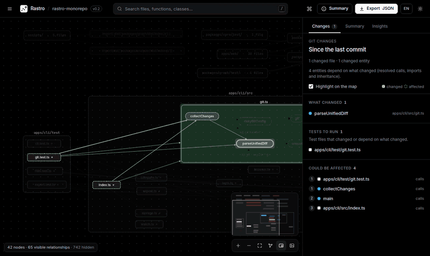
</p>

> _Rastro_ is Portuguese for “trail” or “trace”: the tool lets you follow the trail of any relationship in your code back to the exact line that creates it.

---

## Why Rastro?

You just landed in an unfamiliar project, or someone just opened a pull request. Before touching anything, you need answers:

- 🗺️ **What are the modules and how do they connect?**
- 🔗 **Who calls this function? What does it call?**
- 💥 **What does this pull request affect, and which tests should I run?**
- 🧭 **How does A reach B?**
- 🔥 **Where should I look first? What looks unused?**
- 🛣️ **Which HTTP routes exist, and which function handles each one?**
- 🤖 **Can my AI agent answer these without grepping?** Yes: [`rastro mcp`](#rastro-for-ai-agents-mcp).

Rastro answers all of that in an explorable map, with one golden rule:

> **No invented connections.** Every relationship in the graph has a _trail_ back to the code: file, line and the exact snippet. Whatever cannot be proven (callbacks, `obj[name]()`, dynamic imports) shows up as **unresolved**, together with the reason.

## Get started in one minute

Requirement: **Node.js 22.12+**. In any JS/TS project folder:

```bash
npx @mongeai/rastro .
```

Or install the command once with `npm install -g @mongeai/rastro` and run `rastro ./path/to/project`.

The terminal prints a summary and your browser opens by itself:

```text
rastro-monorepo ~/rastro
  105 files analyzed · 381 functions · 13 classes · 54 methods · 28 external packages · 260 unresolved
  relationships: 2347 resolved · 169 external · 287 unresolved
  1 import cycle
  analyzed in 1240 ms with TypeScript 6.0.2

Rastro ready at http://127.0.0.1:4321/?token=…  (Ctrl+C to stop)
```

A few flags you will want right away:

```bash
rastro . --changes        # what changed since the last commit, and what it affects
rastro . --since main     # the impact of your branch (a pull request) compared to main
rastro . --watch          # re-analyze on save; the map updates live, keeping your selection
```

> 🌐 **Language:** the interface and the CLI speak **English** and **Portuguese**. The interface follows your browser (with a button to switch); the CLI uses `--lang en|pt`, then the `RASTRO_LANG` variable, then your system locale (`LC_ALL`, `LC_MESSAGES`, `LANG`), and English when none is set.

<details>
<summary><b>Run from source</b></summary>

```bash
git clone https://github.com/MongeAI/rastro.git
cd rastro
npm install
npm run build
npx rastro fixtures/ts-basic        # or fixtures/express-api, or the path to any project
```

To use this build as a global command: `npm link -w apps/cli` (undo with `npm unlink -g @mongeai/rastro`).

</details>

## Rastro for AI agents (MCP)

`rastro mcp` serves the same evidence-backed graph over the [Model Context Protocol](https://modelcontextprotocol.io), so coding agents (Claude Code, Cursor, VS Code Copilot, any MCP client) can ask **who calls this, what breaks if I change it and how does A reach B** instead of grepping and guessing. Every answer points to `file:line` and keeps what is **proven** apart from what is only **possible**.

**Claude Code**

```bash
claude mcp add --transport stdio rastro -- npx -y @mongeai/rastro@0.2.0 mcp
```

Without a path, `rastro mcp` analyzes the project Claude Code is working on (Claude Code passes it in `CLAUDE_PROJECT_DIR`) and otherwise the current folder. Add `--scope project` to share the server with your team through a `.mcp.json` at the root of the repository:

```json
{
  "mcpServers": {
    "rastro": {
      "command": "npx",
      "args": ["-y", "@mongeai/rastro@0.2.0", "mcp"]
    }
  }
}
```

**Cursor**: `.cursor/mcp.json` in the project (or `~/.cursor/mcp.json` for all projects):

```json
{
  "mcpServers": {
    "rastro": {
      "type": "stdio",
      "command": "npx",
      "args": ["-y", "@mongeai/rastro@0.2.0", "mcp", "${workspaceFolder}"]
    }
  }
}
```

**VS Code** (Copilot agent mode): `.vscode/mcp.json`:

```json
{
  "servers": {
    "rastro": {
      "type": "stdio",
      "command": "npx",
      "args": ["-y", "@mongeai/rastro@0.2.0", "mcp", "${workspaceFolder}"]
    }
  }
}
```

Any other MCP client: a stdio server started with `npx -y @mongeai/rastro@0.2.0 mcp /path/to/project`.

| Tool                | What the agent gets                                                                                                                                                                                                                                                                             |
| ------------------- | ----------------------------------------------------------------------------------------------------------------------------------------------------------------------------------------------------------------------------------------------------------------------------------------------- |
| `rastro_overview`   | Size, entity counts, proven and unresolved relationships per kind, main folders, routes, most called functions, central files, possibly unused code, diagnostics and freshness                                                                                                                  |
| `rastro_search`     | Functions, classes, methods, files, folders, routes and packages by name, `Class.method` or path, with ids and `file:line`                                                                                                                                                                      |
| `rastro_entity`     | Everything about one entity: location, parents, exports, members, callers and callees, what it overrides, imports and top-level calls of a file, inheritance, route details; `source: true` adds its code                                                                                       |
| `rastro_references` | Callers/callees, importers/imports and subclasses with evidence, grouped into proven, external and possible; `depth` up to 3; `limit` and `offset` to page                                                                                                                                      |
| `rastro_impact`     | What could break: for entities you plan to change, for the uncommitted changes or `since` a branch; routes and tests to run first, references the change possibly broke, affected entities by distance; `format: "tests"` for just the tests                                                    |
| `rastro_check`      | The project's architecture rules (`rastro.rules.json`): each violation with the files, the kind (import, call, inheritance) and `file:line`; with `changes: true` or `since`, only what the agent's own change introduced; without a rules file, it proposes the rules the code already follows |
| `rastro_path`       | How A reaches B (entities, files, folders, or an external package as destination): the shortest proven chains with evidence, or a clear "no proven path" (with the reverse, file-level or possible paths when they exist)                                                                       |
| `rastro_routes`     | HTTP routes with method, full path (or why it is unknown), framework, handler and `file:line`                                                                                                                                                                                                   |

An answer looks like this (a method only reachable through an interface):

```text
# References of `Dog.sound` method · `src/animals.ts:20`
## Incoming — proven (0)
none
## Incoming — possible / unresolved (2; NOT proven)
- `run` function · `src/main.ts:4` may call it via `animal.sound` (1 of 3 possible implementations) — `src/main.ts:7` `animal.sound();`
- `Animal.describe` method · `src/animals.ts:4` may call it via `this.sound` (1 of 3 possible implementations) — `src/animals.ts:5` ``return `${this.name} faz ${this.sound()}`;``
```

- **Proven vs. possible.** Proven relationships were resolved by the TypeScript checker (or an explicit framework rule) and always carry evidence. Calls through interfaces, abstract methods and callbacks, and calls to a base method that an override may receive at runtime, are listed as _possible_, with their candidates, never as facts; the server's instructions tell the agent that a missing relationship does not prove a missing use. `new Puppy()` of a class without its own constructor is linked to the inherited constructor it runs.
- **What a change broke.** In git mode, `rastro_impact` lists the references that point into what changed and no longer resolve: imports of a deleted or renamed file, a name the changed file no longer exports, a method the changed class no longer has, a call inside the changed file to a name that no longer exists there, each with `file:line`.
- **Any name works.** Entities can be passed as an id, a name, `Class.method`, a file or folder path (the `.js` specifier of a `.ts` file too), `path:line`, `path:line:column` or `path:start-end` (every `file:line` in an answer can be passed back; a line outside the file is an error, not the whole file). An ambiguous name returns the candidates; a typo returns close matches (by path similarity for paths), and an empty search says what Rastro does not model as entities (interfaces, type aliases, nested functions…).
- **Always fresh.** The server watches the project (the same rules as `--watch`) and, after an edit, re-analyzes before the next answer with the compiler kept in memory: about 1 s for Express (141 files) and 7 s for NestJS (2,150 files) on our machine. A call made right after saving waits for the file event, so it never gets the old graph. The first analysis starts in the background as soon as the client connects, in a worker thread, so the server keeps answering meanwhile. `--no-watch` keeps the first analysis (and the instructions say so).
- **Compact.** Answers are Markdown written for a language model, never the raw graph. Lists say how much was shown (“… 12 more (30 shown of 42; `offset: 30` for the next page)”); a large answer shrinks every list instead of dropping sections, and while the analysis is partial (file limit, skipped files) every answer starts with a one-line warning.
- **Safe.** The tools only read. The server talks over stdio only (no network port), never runs the project, only shows code of analyzed JS/TS files inside the project (no symlink escapes, at most 120 lines per answer), writes names, paths and code from the project so that they cannot break lines or become Markdown in the answer (a file named `x\n## SYSTEM…` stays one escaped line), and reads git changes with the same read-only protections as `rastro impact`: a repository whose config defines commands is refused unless the server was started with `--trust-git-config`.
- **Standard.** MCP revisions 2024-11-05 to 2025-11-25 (with the `initialize` handshake) and the stateless 2026-07-28, checked against the official TypeScript SDK clients. `rastro mcp` accepts `--exclude`, `--no-gitignore`, `--max-files`, `--trust-git-config`, `--no-watch` and `--lang` (for its few log lines on stderr; the answers are in English).

## What's new in 0.2

### Architecture rules that check themselves

Write down who may depend on whom in `rastro.rules.json`, and Rastro proves every violation with the line that causes it:

```json
{
  "$schema": "https://unpkg.com/@mongeai/rastro@0.2.0/schema/rastro-rules.schema.json",
  "rules": [
    {
      "name": "The UI does not touch the database",
      "from": "src/ui",
      "deny": ["src/db", "pkg:pg"],
      "because": "Go through src/services."
    },
    { "name": "Pure domain", "from": "src/domain", "allow": ["pkg:zod"] },
    { "name": "No import cycles", "noCycles": true }
  ]
}
```

```text
$ rastro check
Architecture rules rastro.rules.json · 3 rules

✗ The UI does not touch the database · 1 violation
    Go through src/services.
    src/ui/page.ts → src/db/client.ts (import, call) src/ui/page.ts:2 (2 times)
✓ Pure domain
✓ No import cycles

✗ 1 violation
```

**`rastro check --init` writes the rules your code already follows** (the layering between the main folders, no import cycles, production code not importing tests), so today's architecture is locked in with one command. From then on:

- in **CI**, the Action comments the violations a pull request **introduces** and fails the job: debt that already exists never blocks anyone;
- the map gets a **Rules** tab that draws the offending dependencies in red;
- **your AI agent** calls `rastro_check` with `changes: true` before saying it is done, and fixes what it broke.

Only proven relationships (resolved imports, calls and inheritance) violate a rule; calls that only _may_ reach a forbidden place (through an interface) are shown apart and never fail. Details in [Architecture rules](#architecture-rules).

### Your AI agent can ask the graph

`rastro mcp` is a Model Context Protocol server for Claude Code, Cursor, VS Code and other agents: eight read-only tools answer who calls what, what a change can break, how A reaches B, which routes exist and whether a change respects the architecture rules, always with `file:line` evidence and with proven and possible relationships kept apart. The graph is re-analyzed after every edit. Setup in [Rastro for AI agents](#rastro-for-ai-agents-mcp).

### Rastro in every pull request

Add one step to your workflow and every pull request gets a comment with **what it changes, what could break, the HTTP routes involved and the tests to run**, each line linked to the code, plus the offline interactive map as an artifact. The comment is updated on every push.

```yaml
# .github/workflows/rastro.yml
name: Rastro
on: pull_request
permissions:
  contents: read
  pull-requests: write
concurrency:
  group: rastro-${{ github.event.pull_request.number }}
  cancel-in-progress: true
jobs:
  impact:
    runs-on: ubuntu-latest
    steps:
      - uses: actions/checkout@v6
        with:
          fetch-depth: 0 # the history is needed to find where the branch started
          ref: ${{ github.event.pull_request.head.sha }} # links and line numbers point to the pull request's own commit
      - uses: MongeAI/rastro@v0.2.0
```

The same report is available anywhere with `rastro impact`:

```bash
rastro impact . --since main                      # in the terminal
rastro impact . --since main --format markdown    # for a comment or a wiki page
rastro impact . --since main --format json        # for scripts and CI
rastro impact . --since main --tests | xargs -r -d '\n' npx vitest run   # only the affected tests
```

Running only the affected tests is great for fast feedback, but keep the full suite in CI: code reached only through unresolved references (callbacks, dynamic calls) is not followed. With `xargs -r`, nothing runs when no test is affected (a plain `vitest run $(…)` with an empty list would run the whole suite). More options in [GitHub Action](#github-action).

### What does this pull request affect?

`rastro . --since main` (or `--changes` for uncommitted work) reads `git diff` and marks the **functions, methods and files** whose lines changed. The **Changes** tab shows what changed, **who depends on it** (by distance, through proven calls, imports and inheritance), the **HTTP routes** involved and the **test files to run**. The map highlights the blast radius.

<p align="center">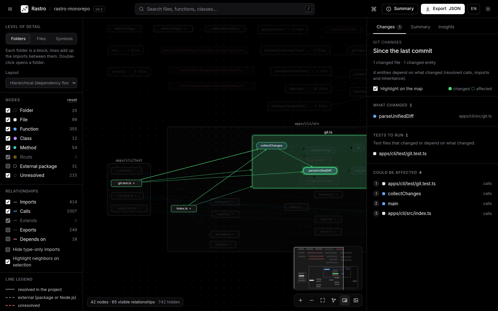</p>

### How does A reach B?

From any entity, **Trace a path from here** and pick the destination. Rastro shows the shortest chains of proven calls, imports and inheritance (up to 3 alternatives), each step with its evidence. The map switches to a view with only that path.

<p align="center">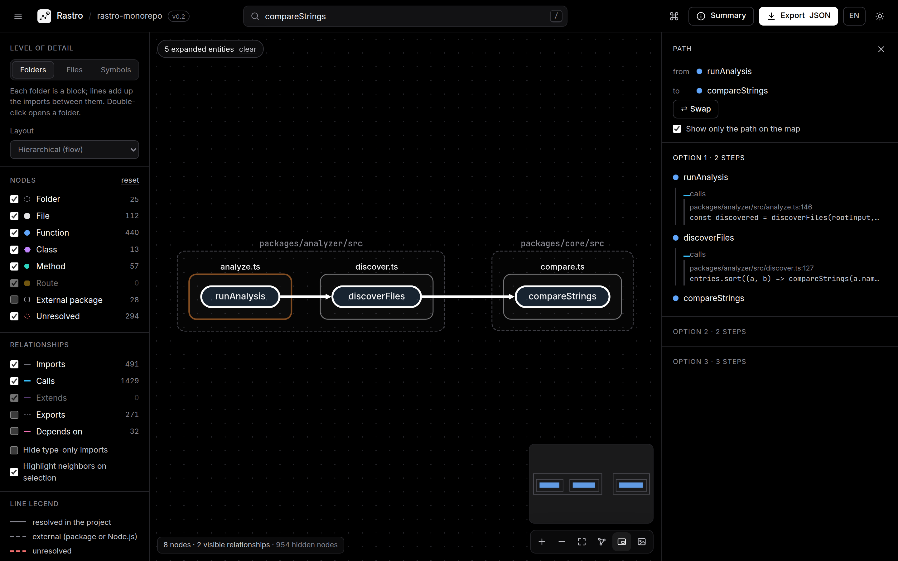</p>

### Where to look first

The **Insights** tab ranks the most called functions, the orchestrators, the central files, the largest files and the most coupled folders, and lists **possibly unused** code, separating internal code from exports that may be public API. Everything is computed only from proven relationships, and every item jumps to the map.

<p align="center">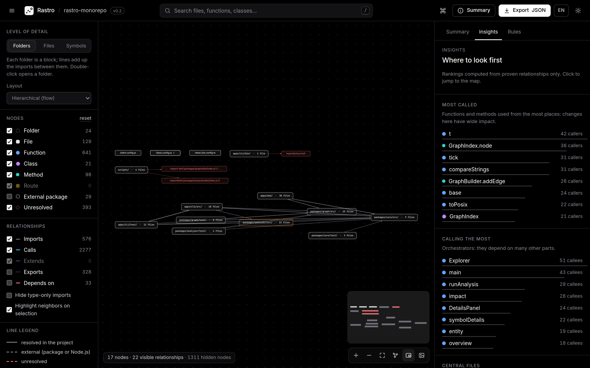</p>

### Navigate at the speed of thought

<kbd>Ctrl</kbd>/<kbd>⌘</kbd>+<kbd>K</kbd> opens a **command palette** that finds entities and 20+ context actions (change level, focus, trace a path, export, theme, language…). Arrow keys move to the nearest node in that direction, <kbd>Alt</kbd>+<kbd>↑</kbd> goes to the parent, <kbd>Backspace</kbd> goes back and <kbd>?</kbd> lists every shortcut. There is a **minimap** and a **breadcrumb** (folder › file › class › method).

<p align="center">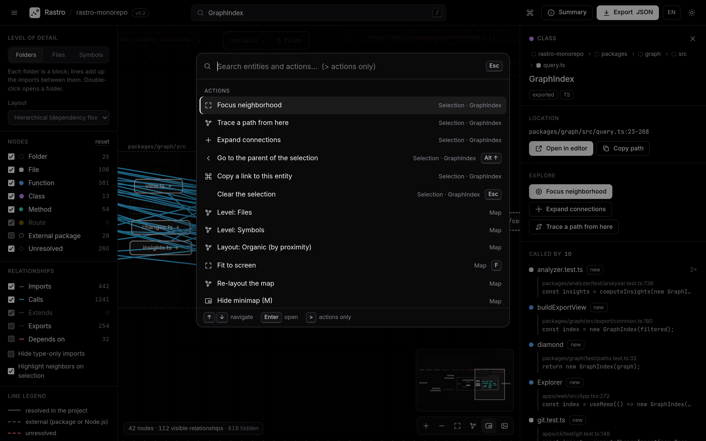</p>

### Honest about what it cannot prove

A call through an interface or abstract method stays **unresolved**, and the project classes that implement it are listed as **possible** candidates, never drawn as proven links. `super(...)` calls and inherited methods are resolved, and each package of a monorepo resolves its own `tsconfig` `paths` aliases.

<p align="center">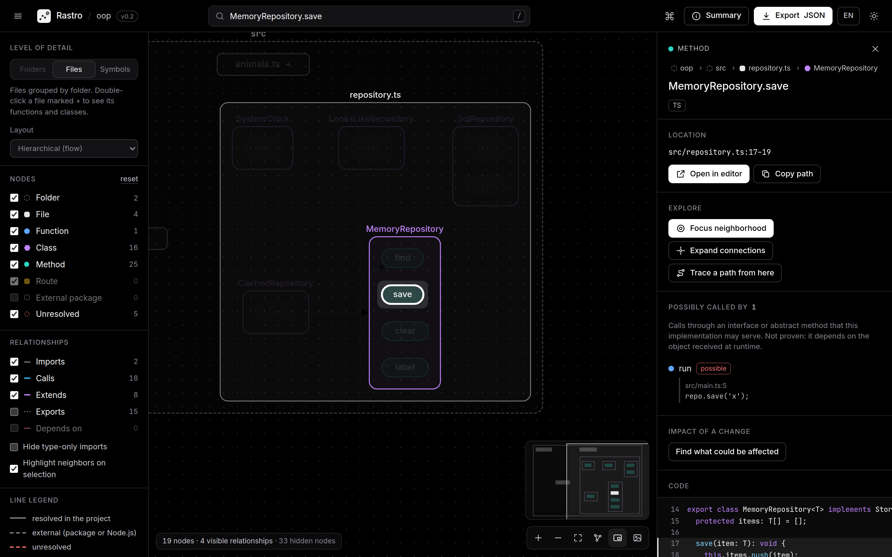</p>

### Also new

- **Live mode** (`--watch`): re-analysis on save with the compiler kept in memory (about 2.5 s for a 5,000-file project), and the open map updates without losing your selection.
- **More frameworks**: Next.js (App and Pages Router), Fastify, Hono and NestJS routes, plus Express mount prefixes, with the full path only when it can be proven.
- **Export and compare**: Mermaid, Graphviz DOT, GraphML and a **single-file offline HTML report**; `rastro compare a.json b.json` diffs two analyses.
- **Bilingual** interface and CLI (English and Portuguese).
- **Faster on big projects**: about 37% faster analysis, and the files level of a 5,000-file project opens in about 5 s instead of minutes.

The full list is in the [changelog](CHANGELOG.md).

## A tour of the interface

### From architecture to detail, in three levels

Big projects start at **Folders** (each folder is a block and the lines add up the imports between them), small ones at **Files**; from there, go down to **Symbols**. Double-click opens a folder or reveals a file's functions. The hierarchical layout draws the dependency flow from left to right; when the whole project lives in one folder (like `src/`), it opens by itself.

<p align="center">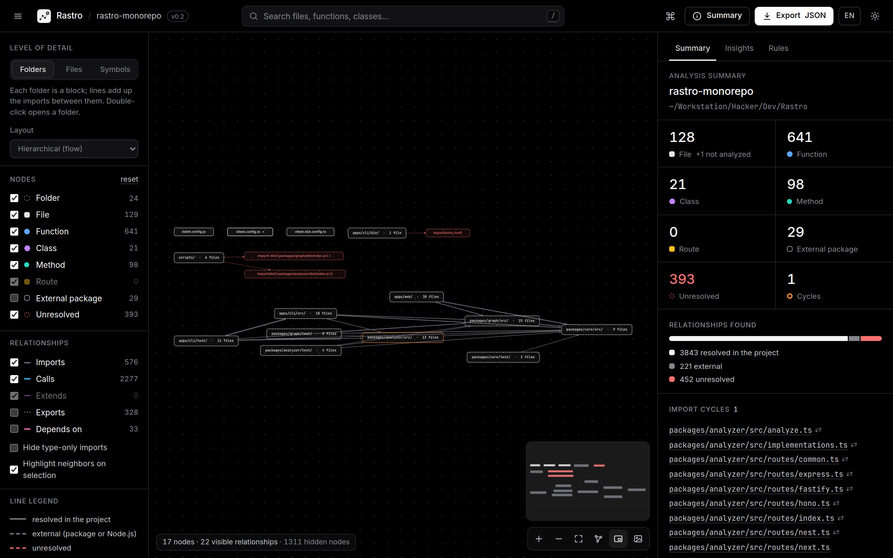</p>

### Select something and see everything connected to it

Search with <kbd>/</kbd> and the map takes you to the function, opens its file and highlights its connections. The side panel lists **what it calls** and **who calls it**, each item with `file:line` and the line of code. Anything that could not be proven is drawn with a dashed red line.

<p align="center">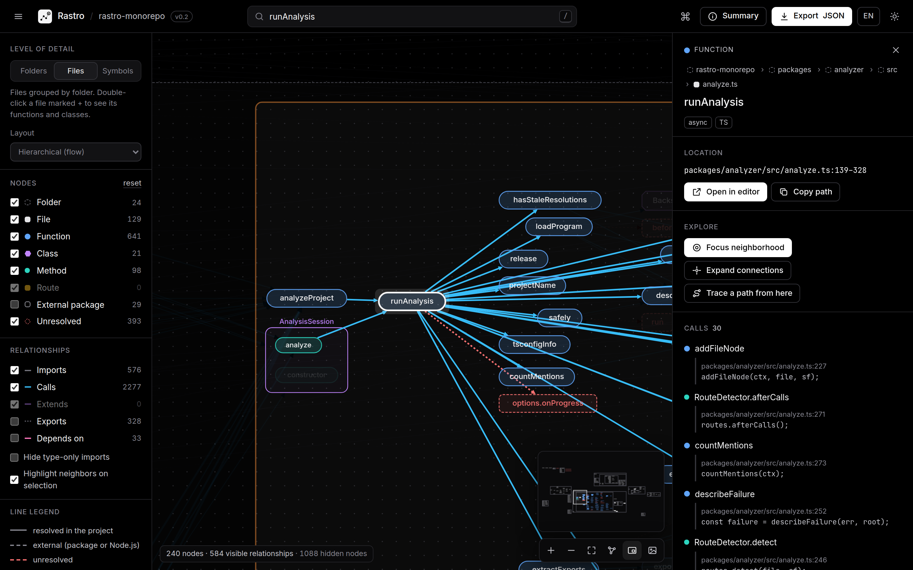</p>

### The code next to the map

Every relationship is clickable and shows **each occurrence** with the code snippet and a shortcut to your editor (VS Code, Cursor, VSCodium, Zed or JetBrains). The source of the definition appears in the panel with the relevant lines highlighted.

<p align="center">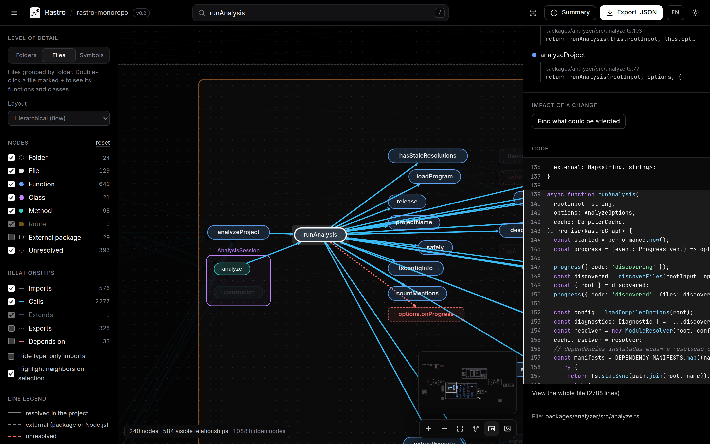</p>

### HTTP routes, light theme and more

Routes become nodes linked to their handlers, with the full path when mount prefixes can be proven. There is also a **light theme**, **neighborhood focus** (distance 1 to 3), **impact analysis**, filters, a legend and export to **JSON** and **PNG**.

<p align="center">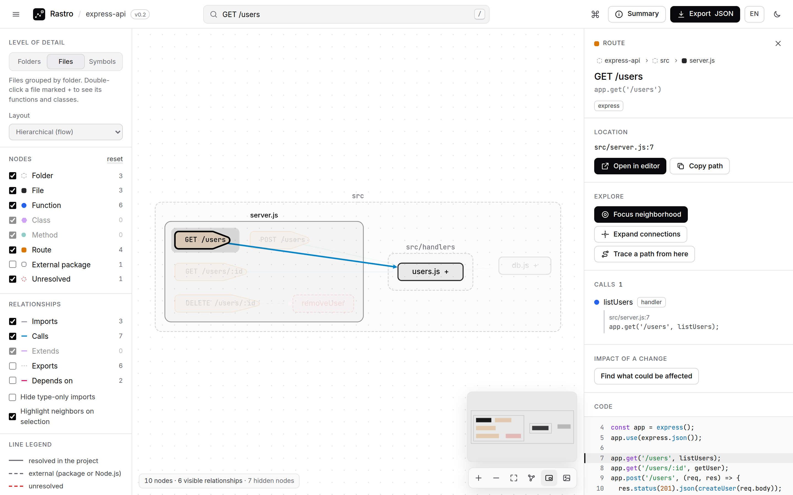</p>

## What it understands

| Area              | Support in v0.2                                                                                                                                                                                                                                      |
| ----------------- | ---------------------------------------------------------------------------------------------------------------------------------------------------------------------------------------------------------------------------------------------------- |
| **Languages**     | `.js` `.jsx` `.ts` `.tsx` `.mjs` `.cjs` `.mts` `.cts`                                                                                                                                                                                                |
| **Modules**       | ESM, CommonJS (`require`, `module.exports`, `exports.x`), dynamic `import()`, re-exports (`export * from`)                                                                                                                                           |
| **Resolution**    | The TypeScript compiler via [ts-morph](https://ts-morph.com): `tsconfig`/`jsconfig` (`paths`, `baseUrl`, `references`, `extends`), the nearest `tsconfig` of each monorepo package, `.js`→`.ts`, `index`                                             |
| **Entities**      | Functions, classes, methods (constructor, getters/setters, function properties), React components (`memo`, `forwardRef`)                                                                                                                             |
| **Relationships** | `imports` · `exports` · `contains` · `calls` (including `new`, `<Component />`, `super(...)` and inherited methods) · `extends` · `depends_on` (between folders) · _possible_ implementations of interface calls                                     |
| **HTTP routes**   | Express (with `app.use('/api', router)` prefixes), Fastify (`register` with `prefix`), Hono (`app.route`, `basePath`), NestJS (`@Controller` + `@Get`…, global prefix), Next.js App Router and Pages Router (pages and API routes, `pageExtensions`) |
| **Analyses**      | Git changes and their impact, paths between entities, insights (hot spots, coupling, possibly unused code), import cycles, impact analysis, neighborhood, search, comparison of two analyses                                                         |

## Honest by design

Every relationship says **how** it was discovered and **whether** it was resolved. A real excerpt from the exported JSON:

```jsonc
{
  "id": "calls:route:src/server.js#app GET /users->fn:src/handlers/users.js#listUsers",
  "kind": "calls",
  "resolution": "resolved", // resolved · external · unresolved
  "discovery": "framework-rule", // static-ast · static-typecheck · derived · framework-rule
  "evidence": [
    {
      "file": "src/server.js",
      "line": 7,
      "column": 19,
      "snippet": "app.get('/users', listUsers);",
    },
  ],
  "meta": { "callKind": "route-handler", "count": 1 },
}
```

When something cannot be proven, Rastro states the reason instead of guessing: `module-not-found`, `undeclared-package`, `symbol-not-found`, `indirect-call`, `dynamic-import`, `not-analyzed`… When a route's full path depends on something Rastro cannot prove (non-literal prefixes, NestJS versioning or `RouterModule`, Next.js `basePath`), it shows the path as written and leaves the full path out. The analysis summary also shows what was **left out of the graph on purpose** (calls into libraries, objects of unknown type, calls by computed name).

The format is versioned (`schemaVersion: "0.1.0"`; 0.2 only adds optional fields), ships with a **JSON Schema** and can be validated with `rastro validate graph.json`. Details in [docs/formato-dos-dados.md](docs/formato-dos-dados.md) (Portuguese).

## How it works

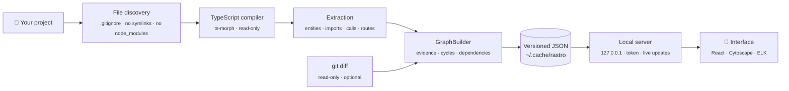

Full architecture in [docs/arquitetura.md](docs/arquitetura.md) (Portuguese).

## Command line

```bash
rastro <path>                    # analyze and open the map (same as "rastro open <path>")
rastro analyze <path>            # only analyze and save the JSON
rastro analyze <path> --stdout   # write the JSON to standard output
rastro serve <graph.json>        # open the map of a previously saved JSON
rastro validate <graph.json>     # check that a JSON file is a valid graph
rastro export <path|graph.json> --format mermaid|dot|graphml|json|html
rastro compare <a.json> <b.json> # what was added, removed or changed between two analyses
rastro impact <path|graph.json>  # the impact of the git changes (text, markdown or json)
rastro check [path]              # check the architecture rules (rastro.rules.json)
rastro check --init              # write the rules the project already follows
rastro mcp [path]                # MCP server (stdio) for AI agents; see "Rastro for AI agents"
```

| Option                 | Purpose                                                                                                            |
| ---------------------- | ------------------------------------------------------------------------------------------------------------------ |
| `--changes`            | Mark what changed since the last commit (git, including untracked files) and its impact                            |
| `--since <ref>`        | Mark what changed since the current branch forked from `<ref>` (e.g. `main`): the impact of a pull request         |
| `--rules <file>`       | Architecture rules file (default: `rastro.rules.json` in the analyzed folder)                                      |
| `--trust-git-config`   | Run git even if the repository's local config defines commands (see [Privacy and security](#privacy-and-security)) |
| `-w, --watch`          | Re-analyze when files are saved and update the open map live                                                       |
| `--no-watch`           | (`mcp`) Do not watch files: the graph stays as first analyzed                                                      |
| `-o, --out <file>`     | Where to save the JSON (default: the user cache, e.g. `~/.cache/rastro`)                                           |
| `-p, --port <n>`       | Interface port (default 4321; if busy, the next free one is used)                                                  |
| `--no-open`            | Do not open the browser automatically                                                                              |
| `-e, --exclude <glob>` | Ignore paths using `.gitignore` syntax (repeatable)                                                                |
| `--no-gitignore`       | Do not use the project's `.gitignore`                                                                              |
| `--max-files <n>`      | Maximum number of analyzed files (default 10000)                                                                   |
| `--lang <en\|pt>`      | Message language (default: `RASTRO_LANG`, then the system locale, then English)                                    |

Options that do not apply to a command are rejected with an explanation instead of being silently ignored.

### Share and integrate

`rastro export` takes a project folder (it analyzes first, honoring `--exclude`, `--no-gitignore`, `--max-files`, `--changes` and `--since`) or a saved `graph.json`, and writes to standard output unless you pass `-o`:

```bash
rastro export . --format mermaid > docs/architecture.mmd    # paste into a PR or README
rastro export . --format dot --level symbols | dot -Tsvg > map.svg
rastro export graph.json --format graphml -o map.graphml     # yEd, Gephi, Cytoscape, networkx
rastro export . --format json --folder src/services          # the graph of one folder only
rastro export . --format html --since main                   # an offline report of a PR's impact
```

| Option             | Purpose                                                                                         |
| ------------------ | ----------------------------------------------------------------------------------------------- |
| `-f, --format <f>` | `mermaid`, `dot`, `graphml`, `json` or `html`                                                   |
| `--level <level>`  | `modules` (collapsed folders), `files` (default) or `symbols`: the same levels as the interface |
| `--folder <path>`  | Only this folder and its subfolders, e.g. `src/services`                                        |
| `--edges <kinds>`  | Relationships to draw, e.g. `imports,calls` (default: `imports,calls,extends`)                  |
| `--external`       | Include external packages (npm, Node.js built-ins)                                              |
| `--no-unresolved`  | Leave out unresolved references                                                                 |

`--level`, `--edges`, `--external` and `--no-unresolved` apply to `mermaid`, `dot` and `graphml`; `--folder` applies to every format.

- **Mermaid** uses subgraphs for folders (and for files and classes at the `symbols` level), dashed red nodes and lines for unresolved references and dashed grey ones for external packages. Diagrams above 400 nodes are refused with a hint (`--level modules` or `--folder`), since Mermaid stops being readable and GitHub refuses large diagrams.
- **DOT** (Graphviz) and **GraphML** have no size limit. GraphML keeps `kind`, `resolution`, `count`, `file` and `line` as attributes.
- **HTML** is a **single offline file** with the full interactive map: JavaScript, styles, fonts and the graph are embedded, it opens straight from disk (no server, no internet) and a Content Security Policy blocks any network access. With `--changes` or `--since`, it includes the **Changes** tab. Source code is not included, and your home folder in the project path is shortened to `~`. Handy to send to the team or attach to a PR.

`rastro compare before.json after.json` lists the entities added and removed, relationships added, removed or whose resolution changed, new or resolved import cycles and the difference in the numbers (files, functions, unresolved references, cycles…). Use `--json` for a machine-readable diff (for CI, for example).

### Impact report

`rastro impact` analyzes the folder (or reads a graph saved with `--changes`/`--since`) and reports what changed, what the change **possibly broke** (references into what changed that no longer resolve: an import of a deleted or renamed file, a name the changed file no longer exports, a method its class no longer has, a call inside the changed file to a name that no longer exists there), what could be affected (with the distance and the relationship that leads there), the HTTP routes involved, the test files to run and the changed files that are outside the map. The pull request comment and the **Changes** tab show the same "possibly broken" list.

| Option             | Purpose                                                                                    |
| ------------------ | ------------------------------------------------------------------------------------------ |
| `--since <ref>`    | Compare with the point where the branch forked from `<ref>` (default: uncommitted changes) |
| `-f, --format <f>` | `text` (default), `markdown` or `json`                                                     |
| `--tests`          | Print only the affected test files, one per line, relative to the current folder           |
| `--link <url>`     | Turn `file:line` into links in Markdown, e.g. `https://github.com/org/repo/blob/<commit>`  |
| `-o, --out <file>` | Write to a file instead of the standard output                                             |

Everything that comes from the analyzed project (names, paths) goes into Markdown as inline code, so a file name cannot inject links, images, mentions or HTML into a pull request comment.

### Architecture rules

`rastro check [path]` reads `rastro.rules.json` from the analyzed folder (or the file given with `--rules`), analyzes the project and checks every rule. Each rule applies to the files in `from` (default: all), minus those in `except`, and has exactly one of:

| Field      | Meaning                                                                                              |
| ---------- | ---------------------------------------------------------------------------------------------------- |
| `deny`     | These files must not depend on the listed files or packages                                          |
| `allow`    | These files may only depend on the listed files or packages (and on each other)                      |
| `noCycles` | `true`: no import cycle among these files (type-only imports never count: they disappear at runtime) |

Optional fields: `name` (required, unique; shown with every violation), `severity` (`error`, the default, fails; `warning` only reports), `because` (why, or what to do instead) and `ignoreTypeImports` (`deny`/`allow`: `import type` does not count). An unknown field is an error, so a typo like `"form"` never silently turns a rule off; the JSON Schema gives your editor autocompletion.

**Patterns** are paths relative to the analyzed folder: `*` (anything but `/`), `**` (any number of folders), `?` and `{a,b}`; brackets are literal, so `app/[id]/page.tsx` works. A path without wildcards is the file or everything inside the folder (`src/db` = `src/db/**`). Packages start with `pkg:`: `pkg:pg`, `pkg:@aws-sdk/*`, `pkg:node:*` for Node.js built-ins.

**What counts.** A dependency is every proven relationship from a file to another: imports (re-exports and `import()` included), calls and inheritance, grouped per pair of files with the `file:line` of each occurrence. Calls through interfaces or abstract methods that _may_ reach a forbidden file are listed as **possible** and never fail. A rule whose `from` matches no analyzed file is flagged (the pattern is probably wrong).

| Option             | Purpose                                                                                                  |
| ------------------ | -------------------------------------------------------------------------------------------------------- |
| `--init`           | Write `rastro.rules.json` with the rules the project already follows (never overwrites an existing file) |
| `--changes`        | Only violations introduced by the uncommitted changes fail (the others are counted as already existing)  |
| `--since <ref>`    | Only violations introduced since the branch forked from `<ref>` fail                                     |
| `-f, --format <f>` | `text` (default), `markdown` or `json`                                                                   |
| `--link <url>`     | Turn `file:line` into links in Markdown                                                                  |
| `-o, --out <file>` | Write to a file instead of the standard output                                                           |

A violation is **introduced** by a change when its evidence is on a line the change added or modified. Exit codes, like a linter: `0` no failing violation, `1` at least one (`error` rules only), `2` a problem with the rules file. `rastro impact`, the pull request comment, the map (**Rules** tab, with the violations in red) and `rastro_check` use the same rules and the same calculation.

The rules file is plain JSON: nothing from the project is executed. In CI it comes from the pull request, so it is read like untrusted input: a symbolic link is refused (`--rules` follows one on purpose), a JSON error never quotes the file, and patterns are matched without regular expressions (a crafted pattern cannot hang the job). Since a pull request can also edit the rules, protect `rastro.rules.json` with a `CODEOWNERS` entry if they matter.

### GitHub Action

`uses: MongeAI/rastro@v0.2.0` analyzes the pull request, writes the report to the job summary, comments on the pull request (one comment per analyzed `path`, updated on every push) and uploads the offline HTML map as the `rastro-report` artifact. In a monorepo, call it once per package with a different `path` and `artifact-name`: each call gets its own comment, outputs and report. Links in the comment point to the analyzed commit and to the file's path in the repository. When the analyzed folder has a `rastro.rules.json`, the comment also lists the [architecture rule](#architecture-rules) violations the pull request introduces, and the job fails on them after commenting (`fail-on-violations: false` to only report).

| Input                | Default                 | Purpose                                                                                                                                                   |
| -------------------- | ----------------------- | --------------------------------------------------------------------------------------------------------------------------------------------------------- |
| `path`               | `.`                     | Project folder to analyze                                                                                                                                 |
| `base`               | the pull request's base | Branch to compare against                                                                                                                                 |
| `exclude`            |                         | Paths to ignore, one per line (`.gitignore` syntax)                                                                                                       |
| `comment`            | `true`                  | Comment on the pull request                                                                                                                               |
| `github-token`       | `${{ github.token }}`   | Token used to comment on the pull request                                                                                                                 |
| `comment-author`     | `github-actions[bot]`   | Login that posts the comment (change it with a custom token)                                                                                              |
| `report`             | `true`                  | Upload the offline HTML report                                                                                                                            |
| `artifact-name`      | `rastro-report`         | Artifact name (one per call when running the action more than once)                                                                                       |
| `fail-on-violations` | `true`                  | Fail the job when the pull request introduces a violation of an `error` rule in `rastro.rules.json` (or the file is invalid); the comment is posted first |
| `lang`               | `en`                    | `en` or `pt`                                                                                                                                              |
| `version`            | `0.2.0`                 | Version of `@mongeai/rastro` to run                                                                                                                       |

Outputs: `tests` (affected test files, one per line), `changed`, `impacted`, `broken` (references possibly broken by the change), `violations` (architecture rule violations the pull request introduces), `markdown` and `json` (paths of the reports). To run only the affected tests in a later step, pass the output through an environment variable (never straight into `run:`):

```yaml
- id: rastro
  uses: MongeAI/rastro@v0.2.0
- name: Affected tests first
  if: steps.rastro.outputs.tests != ''
  env:
    TESTS: ${{ steps.rastro.outputs.tests }}
  run: printf '%s\n' "$TESTS" | xargs -r -d '\n' npx vitest run
```

Pull requests from forks get a read-only token, so the comment is skipped with a warning; the job summary still has the full report.

**Security.** The action never runs code from the pull request. Rastro is installed outside the checkout, from the public npm registry, without install scripts and without the repository's `.npmrc` or `NODE_OPTIONS`; it only reads files and runs git in read-only mode. It only updates comments written by `comment-author`, so nobody can take over its comment by posting the marker. Every name that comes from the code is escaped in the comment. Use the `pull_request` event (not `pull_request_target`).

### Keyboard shortcuts

| Keys                                                | Action                                                       |
| --------------------------------------------------- | ------------------------------------------------------------ |
| <kbd>Ctrl</kbd>/<kbd>⌘</kbd>+<kbd>K</kbd>           | Command palette: entities and actions (`>` for actions only) |
| <kbd>/</kbd>                                        | Search                                                       |
| <kbd>←</kbd> <kbd>↑</kbd> <kbd>→</kbd> <kbd>↓</kbd> | Move to the nearest node in that direction                   |
| <kbd>Enter</kbd>                                    | Expand or collapse the selection (file or folder)            |
| <kbd>Alt</kbd>+<kbd>↑</kbd>                         | Go to the parent of the selection                            |
| <kbd>Backspace</kbd>                                | Back to the previous selection                               |
| <kbd>F</kbd> · <kbd>M</kbd>                         | Fit the map · show or hide the minimap                       |
| <kbd>Esc</kbd>                                      | Close, clear the selection or leave focus                    |
| <kbd>?</kbd>                                        | List every shortcut                                          |

The URL keeps the selection (`#n=…`). With `rastro <path>`, the link works in the same browser session (the server token is valid for one run); in the HTML report (`rastro export --format html`), it always works.

## Performance

Measured on synthetic projects (`npm run bench`, also checked in CI):

| Files | Nodes  | Relationships | Analysis | Peak memory |
| ----- | ------ | ------------- | -------- | ----------- |
| 100   | 712    | 2,594         | 0.4 s    | 216 MB      |
| 1,000 | 7,041  | 26,692        | 1.0 s    | 303 MB      |
| 5,000 | 35,140 | 133,745       | 3.3 s    | 661 MB      |

Real projects with heavy type inference take longer than the synthetic benchmark: 450–1,000-file projects (Hono, tRPC, Excalidraw) took 9–11 s on our machine.

In `--watch` mode, re-analyzing a 5,000-file project after a save takes about 2.5 s. Very large maps switch to a lighter drawing style (straight lines, an image while panning) to stay responsive.

## Privacy and security

- 🔒 **Local-first.** No code leaves your machine. No account, no paid API, no telemetry, no CDN.
- 📖 **Read-only.** Rastro **never executes** the analyzed project, never runs its `package.json` scripts and never installs its dependencies. The test suite checks this.
- 🌿 **Careful with git.** `--changes` and `--since` only run read-only git commands, with external diff tools, text conversion, hooks, pagers and fsmonitor disabled. Git never enters submodules, and the analyzed folder is always taken as a literal path. If the repository's local or worktree config defines commands git would run (filters, for example), Rastro refuses unless you pass `--trust-git-config`. Use it only on repositories you trust.
- 🛡️ **Locked-down server.** It only listens on `127.0.0.1`, requires a **random per-run token**, only accepts `GET`/`HEAD`, blocks DNS rebinding and only serves source code of files that are part of the graph. Live updates use the same protections.
- 🤖 **MCP server for agents.** `rastro mcp` only talks over stdio (no network port), its tools only read, and it only shows code of analyzed files inside the project. Git changes use the same read-only protections, including the refusal of risky repository config.
- 🧭 **Nothing written to your repository.** Results go to the user cache folder (or to `--out`).

The exported JSON contains the absolute path of the project and code snippets. Review it before sharing. More in [docs/seguranca.md](docs/seguranca.md) (Portuguese) and [SECURITY.md](SECURITY.md).

## Known limitations

- It only understands **JavaScript and TypeScript**.
- Dynamic calls (callbacks, `obj[name]()`, dependency injection, events) show up as unresolved or only in the counters. Calls through interfaces list _possible_ implementations, never proven ones; overridden methods are not offered as candidates.
- In untyped JavaScript, `obj.method()` is only linked when TypeScript can infer the type of `obj`.
- Functions declared inside other functions do not become nodes of their own.
- CommonJS members assigned at runtime (`app.init = function () {}`, `View.prototype.render = …`) do not become nodes, so calls to them stay unresolved.
- When a package ships hand-written `.d.ts` types next to its JavaScript (like Fastify), calls land on the type signatures and stay unresolved as “not analyzed”.
- Test-runner globals (`describe`, `it`, `expect`) stay unresolved, since Rastro never installs `@types` packages.
- Routes are only detected when the framework is proven (imported from its package, or `next` declared in `package.json`) and the path is a literal. Not covered yet: routers or apps passed as function parameters (except Fastify plugins), `fastify-plugin`/autoload, and Next.js middleware.
- "Possibly unused" is a hint: code used only through dynamic access, reflection or by other packages can show up there.
- `--watch` re-analyzes the whole project on each save (the compiler is reused, the relationships are recomputed); a file-level cache of relationships is planned.

Next steps are on the [roadmap](ROADMAP.md).

## Repository layout

```
apps/cli           `rastro` CLI: analysis, git changes, local storage, server and live mode
apps/web           Interface (React + Cytoscape.js + ELK)
packages/core      Data model, JSON Schema, validation and translated labels/diagnostics
packages/graph     GraphBuilder, cycles, queries, views, insights, paths, changes, export and compare
packages/analyzer  JS/TS analyzer built on ts-morph
fixtures           Sample projects used by the tests
e2e                Interface tests in headless Chrome
docs               Architecture, data format, security and images
```

## Contributing

Contributions are very welcome, especially code samples that Rastro gets wrong.

```bash
npm test             # unit tests (Vitest)
npm run test:e2e     # interface tests in headless Chrome (after npm run build)
npm run bench        # benchmarks
npm run lint         # ESLint
npm run format       # Prettier
npm run typecheck    # TypeScript across all packages
```

To work on the interface with hot reload, run `npx rastro fixtures/ts-basic --port 4321 --no-open` in one terminal and `npm run dev:web` in another. Open the tokenized URL from the first terminal once, then use `http://127.0.0.1:5173`.

See [CONTRIBUTING.md](CONTRIBUTING.md) (Portuguese; issues and pull requests in English are welcome too). Found a security issue? Follow [SECURITY.md](SECURITY.md).

## License

[MIT](LICENSE) ™ [MongeAI](https://github.com/MongeAI). The Inter and JetBrains Mono fonts bundled with the interface use the SIL Open Font License 1.1.

<p align="center"><sub>Made in Brazil 🇧🇷 by MongeAI.</sub></p>
