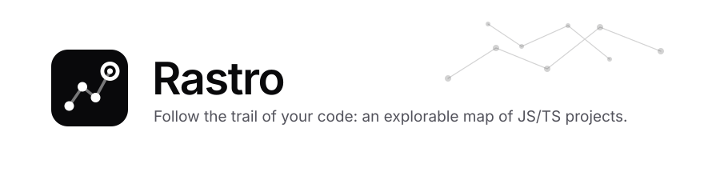
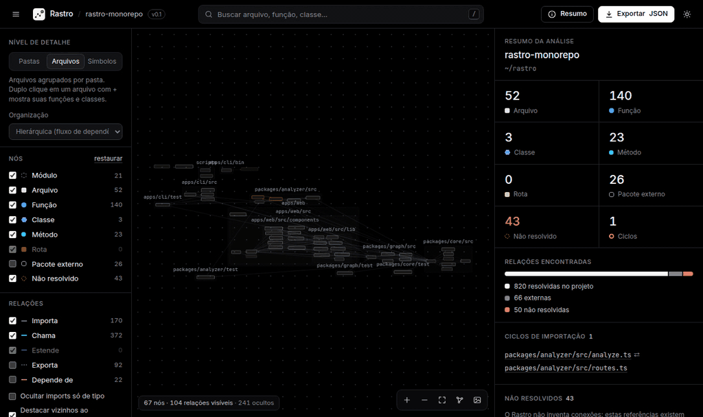
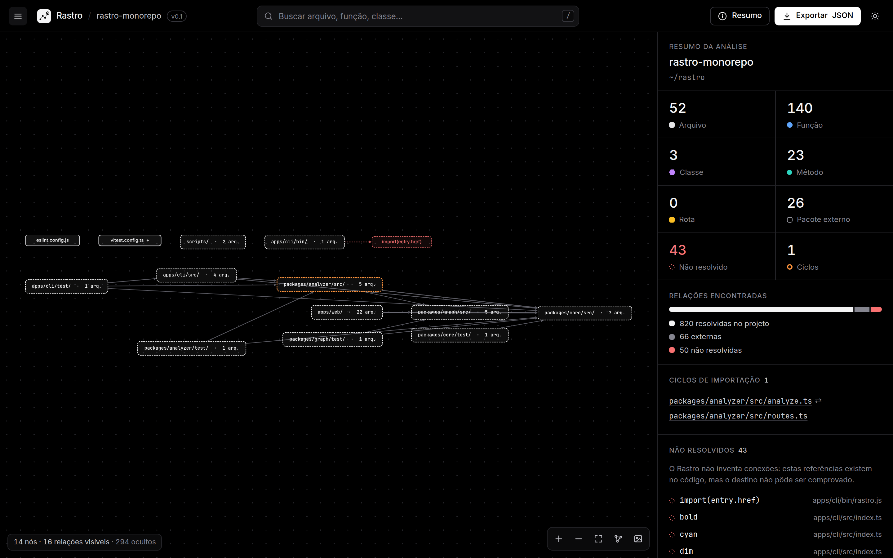
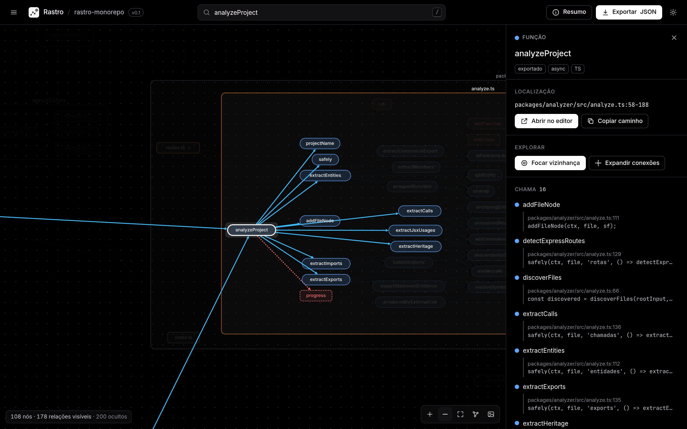
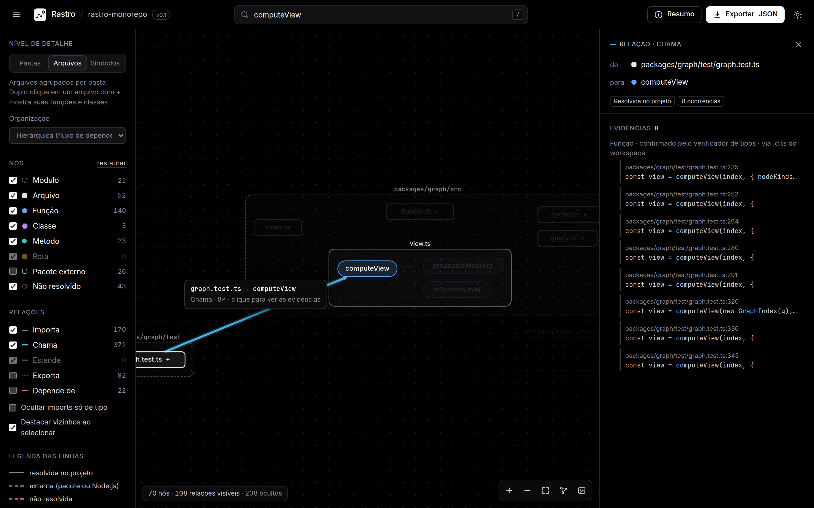
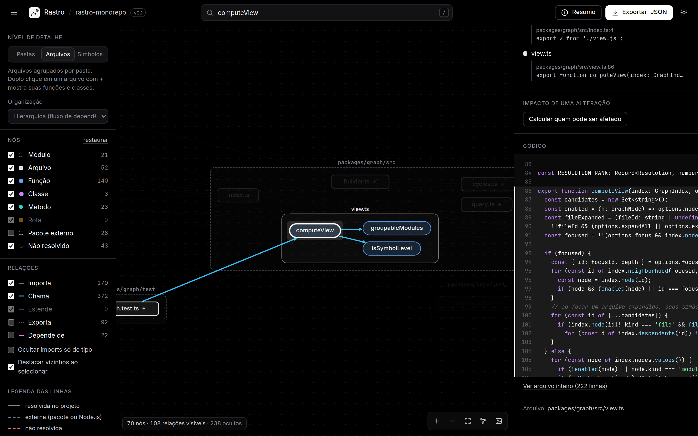
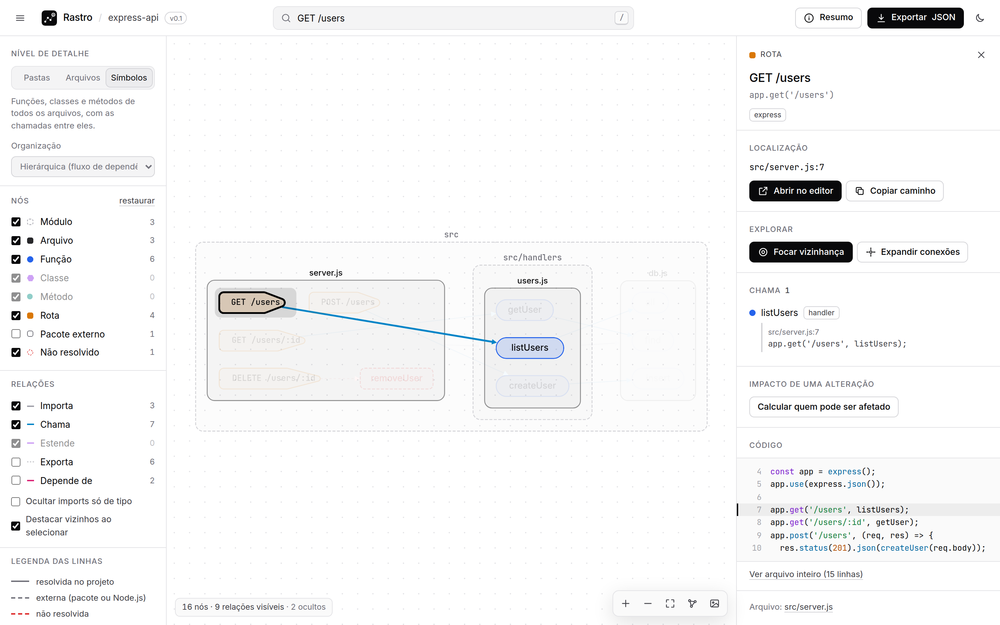
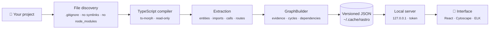

<p align="center">
  <picture>
    <source media="(prefers-color-scheme: dark)" srcset="docs/assets/banner-en-dark.svg" />
    
  </picture>
</p>

<p align="center">
  <b>English</b> · <a href="README.pt-BR.md">Português</a>
</p>

<p align="center">
  <a href="https://github.com/MongeAI/rastro/actions/workflows/ci.yml"></a>
  <a href="https://www.npmjs.com/package/@mongeai/rastro"></a>
  <a href="LICENSE"></a>
  
  
  
</p>

<p align="center">
  <b>Understand code you have never seen in minutes, not days.</b><br />
  Rastro reads a JavaScript/TypeScript repository and opens an <b>interactive map</b> of its folders, files, functions and classes in your browser,<br />
  where <b>every connection points to the file and line that proves it</b>. Everything runs on your machine: no cloud, no mandatory AI.
</p>

<p align="center">
  
</p>

> _Rastro_ is Portuguese for “trail” or “trace”: the tool lets you follow the trail of any relationship in your code back to the exact line that creates it.

---

## Why Rastro?

You just landed in an unfamiliar project. Before touching anything, you need answers:

- 🗺️ **What are the modules and how do they connect?**
- 🔗 **Who calls this function? What does it call?**
- 💥 **If I change this, what might break?**
- 🔁 **Are there import cycles?**
- 🛣️ **Which HTTP routes exist, and which function handles each one?**
- ❓ **What does the code reference that cannot be proven statically?**

Rastro answers all of that in an explorable map, with one golden rule:

> **No invented connections.** Every relationship in the graph has a _trail_ back to the code: file, line and the exact snippet. Whatever cannot be proven (callbacks, `obj[name]()`, dynamic imports) shows up as **unresolved**, together with the reason.

## Get started in one minute

Requirement: **Node.js 22.12+**. In any JS/TS project folder:

```bash
npx @mongeai/rastro .
```

Or install the command once with `npm install -g @mongeai/rastro` and run `rastro ./path/to/project`.

The terminal prints a summary and your browser opens by itself:

```text
rastro-monorepo ~/rastro
  51 arquivos analisados · 140 funções · 3 classes · 23 métodos · 26 pacotes externos · 43 não resolvidos
  relações: 820 resolvidas · 66 externas · 50 não resolvidas
  1 ciclo(s) de importação
  análise em 1823 ms com TypeScript 6.0.2

Rastro pronto em http://127.0.0.1:4321/?token=…  (Ctrl+C para encerrar)
```

> 🌐 **Language note:** the interface and the CLI messages are currently in **Portuguese** (Rastro is made in Brazil). They are short and icon-driven, and an English UI is on the [roadmap](ROADMAP.md). The data format, the code and this documentation are language-neutral or in English.

<details>
<summary><b>Run from source</b></summary>

```bash
git clone https://github.com/MongeAI/rastro.git
cd rastro
npm install
npm run build
npx rastro fixtures/ts-basic        # or fixtures/express-api, or the path to any project
```

To use this build as a global command: `npm link -w apps/cli` (undo with `npm unlink -g @mongeai/rastro`).

</details>

## A tour of the interface

### 1. From architecture to detail, in three levels

Start at **Folders** (_Pastas_: each folder is a block and the lines add up the imports between them), go down to **Files** (_Arquivos_) and reach **Symbols** (_Símbolos_). Double-click opens a folder or reveals a file's functions. The hierarchical layout draws the dependency flow from left to right.

<p align="center"></p>

### 2. Select something and see everything connected to it

Search with <kbd>/</kbd> and the map takes you to the function, opens its file and highlights its connections. The side panel lists **what it calls** and **who calls it**, each item with `file:line` and the line of code. Anything that could not be proven is drawn with a dashed red line.

<p align="center"></p>

### 3. Click a line to see the evidence

Every edge is clickable: the panel shows **each occurrence** of that relationship, with the code snippet and a shortcut to open it in your editor (VS Code, Cursor, VSCodium, Zed or JetBrains).

<p align="center"></p>

### 4. The code next to the map

The source of the definition appears in the panel with the relevant lines highlighted, without leaving the tool.

<p align="center"></p>

### 5. HTTP routes, light theme and more

HTTP routes from **Express**, **Fastify**, **Hono**, **NestJS** and **Next.js** become nodes linked to their handlers, with the full path when mount prefixes can be proven. There is also a **light theme**, **neighborhood focus** (distance 1 to 3), **impact analysis**, filters, a legend and export to **JSON** and **PNG**.

<p align="center"></p>

## What it understands

| Area              | Support in v0.1                                                                                                                                                                                                     |
| ----------------- | ------------------------------------------------------------------------------------------------------------------------------------------------------------------------------------------------------------------- |
| **Languages**     | `.js` `.jsx` `.ts` `.tsx` `.mjs` `.cjs` `.mts` `.cts`                                                                                                                                                               |
| **Modules**       | ESM, CommonJS (`require`, `module.exports`, `exports.x`), dynamic `import()`, re-exports (`export * from`)                                                                                                          |
| **Resolution**    | The TypeScript compiler via [ts-morph](https://ts-morph.com): `tsconfig`/`jsconfig` (`paths`, `baseUrl`, `references`), `.js`→`.ts`, `index`, monorepos                                                             |
| **Entities**      | Functions, classes, methods (constructor, getters/setters, function properties), React components (`memo`, `forwardRef`)                                                                                            |
| **Relationships** | `imports` · `exports` · `contains` · `calls` (including `new` and `<Component />`) · `extends` · `depends_on` (between folders)                                                                                     |
| **HTTP routes**   | Express (with `app.use('/api', router)` prefixes), Fastify (`register` with `prefix`), Hono (`app.route`, `basePath`), NestJS (`@Controller` + `@Get`…), Next.js App Router and Pages Router (pages and API routes) |
| **Analyses**      | Import cycles, impact analysis, neighborhood, search                                                                                                                                                                |

## Honest by design

Every relationship says **how** it was discovered and **whether** it was resolved. A real excerpt from the exported JSON:

```jsonc
{
  "id": "calls:route:src/server.js#app GET /users->fn:src/handlers/users.js#listUsers",
  "kind": "calls",
  "resolution": "resolved", // resolved · external · unresolved
  "discovery": "framework-rule", // static-ast · static-typecheck · derived · framework-rule
  "evidence": [
    {
      "file": "src/server.js",
      "line": 7,
      "column": 19,
      "snippet": "app.get('/users', listUsers);",
    },
  ],
  "meta": { "callKind": "route-handler", "count": 1 },
}
```

When something cannot be proven, Rastro states the reason instead of guessing: `module-not-found`, `undeclared-package`, `symbol-not-found`, `indirect-call`, `dynamic-import`, `not-analyzed`… The analysis summary also shows what was **left out of the graph on purpose** (calls into libraries, objects of unknown type, calls by computed name).

The format is versioned (`schemaVersion: "0.1.0"`), ships with a **JSON Schema** and can be validated with `rastro validate graph.json`. Details in [docs/formato-dos-dados.md](docs/formato-dos-dados.md) (Portuguese).

## How it works



Full architecture in [docs/arquitetura.md](docs/arquitetura.md) (Portuguese).

## Command line

```bash
rastro <path>                   # analyze and open the map (same as "rastro open <path>")
rastro analyze <path>           # only analyze and save the JSON
rastro analyze <path> --stdout  # write the JSON to standard output
rastro serve <graph.json>       # open the map of a previously saved JSON
rastro validate <graph.json>    # check that a JSON file is a valid graph
rastro export <path|graph.json> --format mermaid|dot|graphml|json|html
rastro compare <a.json> <b.json> # what was added, removed or changed between two analyses
```

| Option                 | Purpose                                                                  |
| ---------------------- | ------------------------------------------------------------------------ |
| `-o, --out <file>`     | Where to save the JSON (default: the user cache, e.g. `~/.cache/rastro`) |
| `-p, --port <n>`       | Interface port (default 4321; if busy, the next free one is used)        |
| `--no-open`            | Do not open the browser automatically                                    |
| `-e, --exclude <glob>` | Ignore paths using `.gitignore` syntax (repeatable)                      |
| `--no-gitignore`       | Do not use the project's `.gitignore`                                    |
| `--max-files <n>`      | Maximum number of analyzed files (default 10000)                         |

### Share and integrate

`rastro export` takes a project folder (it analyzes first, honoring `--exclude`, `--no-gitignore` and `--max-files`) or a saved `graph.json`, and writes to standard output unless you pass `-o`:

```bash
rastro export . --format mermaid > docs/architecture.mmd    # paste into a PR or README
rastro export . --format dot --level symbols | dot -Tsvg > map.svg
rastro export graph.json --format graphml -o map.graphml     # yEd, Gephi, Cytoscape, networkx
rastro export . --format json --folder src/services          # the graph of one folder only
rastro export . --format html                                # ./<project>.rastro.html
```

| Option             | Purpose                                                                                         |
| ------------------ | ----------------------------------------------------------------------------------------------- |
| `-f, --format <f>` | `mermaid`, `dot`, `graphml`, `json` or `html`                                                   |
| `--level <level>`  | `modules` (collapsed folders), `files` (default) or `symbols`: the same levels as the interface |
| `--folder <path>`  | Only this folder and its subfolders, e.g. `src/services`                                        |
| `--edges <kinds>`  | Relationships to draw, e.g. `imports,calls` (default: `imports,calls,extends`)                  |
| `--external`       | Include external packages (npm, Node.js built-ins)                                              |
| `--no-unresolved`  | Leave out unresolved references                                                                 |

- **Mermaid** uses subgraphs for folders (and for files and classes at the `symbols` level), dashed red nodes and lines for unresolved references and dashed grey ones for external packages. Diagrams above 400 nodes are refused with a hint (`--level modules` or `--folder`), since Mermaid stops being readable and GitHub refuses large diagrams.
- **DOT** (Graphviz) and **GraphML** have no size limit. GraphML keeps `kind`, `resolution`, `count`, `file` and `line` as attributes.
- **HTML** is a **single offline file** with the full interactive map: JavaScript, styles, fonts and the graph are embedded, it opens straight from disk (no server, no internet) and a Content Security Policy blocks any network access. Source code is not included, and your home folder in the project path is shortened to `~`. Handy to send to the team or attach to a PR.

`rastro compare before.json after.json` lists the entities added and removed, relationships added, removed or whose resolution changed, new or resolved import cycles and the difference in the numbers (files, functions, unresolved references, cycles…). Use `--json` for a machine-readable diff (for CI, for example).

Interface shortcuts: <kbd>/</kbd> search · <kbd>F</kbd> fit the map · <kbd>Esc</kbd> clear the selection · double-click opens folders and files · the URL keeps the selection (`#n=…`).

## Privacy and security

- 🔒 **Local-first.** No code leaves your machine. No account, no paid API, no telemetry, no CDN.
- 📖 **Read-only.** Rastro **never executes** the analyzed project, never runs its `package.json` scripts and never installs its dependencies. The test suite checks this.
- 🛡️ **Locked-down server.** It only listens on `127.0.0.1`, requires a **random per-run token**, only accepts `GET`/`HEAD`, blocks DNS rebinding and only serves source code of files that are part of the graph.
- 🧭 **Nothing written to your repository.** Results go to the user cache folder (or to `--out`).

The exported JSON contains the absolute path of the project and code snippets. Review it before sharing. More in [docs/seguranca.md](docs/seguranca.md) (Portuguese) and [SECURITY.md](SECURITY.md).

## Known limitations

Rastro is at **v0.1**. Today:

- It only understands **JavaScript and TypeScript**.
- Dynamic calls (callbacks, `obj[name]()`, dependency injection, events) show up as unresolved or only in the counters.
- In untyped JavaScript, `obj.method()` is only linked when TypeScript can infer the type of `obj`.
- Functions declared inside other functions do not become nodes of their own.
- Routes: **Express**, **Fastify**, **Hono**, **NestJS** and **Next.js**, only when the framework is proven (imported from the framework package, or `next` declared in `package.json` for file-based routes) and the path is a literal. Prefixes that are not literals, routers mounted in more than one place, Next.js `basePath` and NestJS versioning leave the full path unknown instead of guessed. Not covered yet: routers or apps passed as function parameters (except Fastify plugins), `fastify-plugin`/autoload, NestJS `RouterModule`, Next.js `pageExtensions` and middleware.
- Monorepos use the root `tsconfig` (and its `references`); `paths` defined only in sub-packages may not be resolved.
- Tested on projects from dozens to a few hundred files; in a synthetic test, about 1,000 files were analyzed in ~3 s. Showing every symbol of a very large project (thousands of nodes) can take a few seconds.
- The interface and CLI messages are in Portuguese for now.

Next steps on the [roadmap](ROADMAP.md): incremental analysis, diffing two versions and the impact of a _pull request_.

## Repository layout

```
apps/cli           `rastro` CLI: analysis, local storage and server
apps/web           Interface (React + Cytoscape.js + ELK)
packages/core      Data model, JSON Schema and validation
packages/graph     GraphBuilder, cycles, queries and view computation
packages/analyzer  JS/TS analyzer built on ts-morph
fixtures           Sample projects used by the tests
docs               Architecture, data format, security and images
```

## Contributing

Contributions are very welcome, especially code samples that Rastro gets wrong.

```bash
npm test             # tests (Vitest)
npm run lint         # ESLint
npm run format       # Prettier
npm run typecheck    # TypeScript across all packages
```

To work on the interface with hot reload, run `npx rastro fixtures/ts-basic --port 4321 --no-open` in one terminal and `npm run dev:web` in another. Open the tokenized URL from the first terminal once, then use `http://127.0.0.1:5173`.

See [CONTRIBUTING.md](CONTRIBUTING.md) (Portuguese; issues and pull requests in English are welcome too). Found a security issue? Follow [SECURITY.md](SECURITY.md).

## License

[MIT](LICENSE) © [MongeAI](https://github.com/MongeAI). The Inter and JetBrains Mono fonts bundled with the interface use the SIL Open Font License 1.1.

<p align="center"><sub>Made in Brazil 🇧🇷 by MongeAI.</sub></p>
