<p align="center">
  <picture>
    <source media="(prefers-color-scheme: dark)" srcset="docs/assets/banner-dark.svg" />
    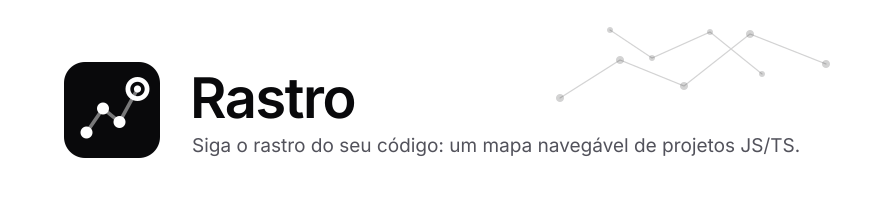
  </picture>
</p>

<p align="center">
  <a href="README.md">English</a> · <b>Português</b>
</p>

<p align="center">
  <a href="https://github.com/MongeAI/rastro/actions/workflows/ci.yml"></a>
  <a href="https://www.npmjs.com/package/@mongeai/rastro"></a>
  <a href="LICENSE"></a>
  
  
  
</p>

<p align="center">
  <b>Entenda um código que você nunca viu em minutos, não em dias.</b><br />
  O Rastro lê um repositório JavaScript/TypeScript e abre no seu navegador um <b>mapa interativo</b> de pastas, arquivos, funções e classes,<br />
  em que <b>cada ligação aponta para o arquivo e a linha que a comprovam</b>. Tudo na sua máquina, sem nuvem e sem IA obrigatória.
</p>

<p align="center">
  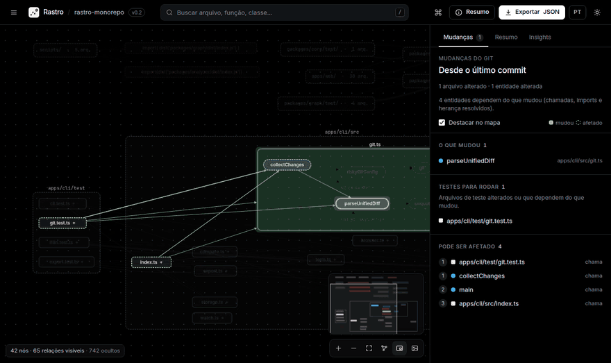
</p>

---

## Por que o Rastro?

Você acabou de cair num projeto desconhecido, ou alguém acabou de abrir um pull request. Antes de mexer em qualquer coisa, você precisa de respostas:

- 🗺️ **Quais são os módulos e como eles se conectam?**
- 🔗 **Quem chama esta função? O que ela chama?**
- 💥 **O que este pull request afeta, e quais testes eu devo rodar?**
- 🧭 **Como A chega em B?**
- 🔥 **Por onde começar? O que parece sem uso?**
- 🛣️ **Quais rotas HTTP existem, e qual função atende cada uma?**

O Rastro responde tudo isso num mapa explorável, com uma regra de ouro:

> **Nenhuma ligação inventada.** Toda relação do grafo tem um _rastro_ até o código: arquivo, linha e o trecho exato. O que não pode ser comprovado (callbacks, `obj[nome]()`, imports dinâmicos) aparece como **não resolvido**, junto com o motivo.

## Comece em um minuto

Requisito: **Node.js 22.12+**. Na pasta de qualquer projeto JS/TS:

```bash
npx @mongeai/rastro .
```

Ou instale o comando uma vez com `npm install -g @mongeai/rastro` e rode `rastro ./caminho/do/projeto`.

O terminal mostra um resumo e o navegador abre sozinho:

```text
rastro-monorepo ~/rastro
  105 arquivos analisados · 381 funções · 13 classes · 54 métodos · 28 pacotes externos · 260 não resolvidos
  relações: 2347 resolvidas · 169 externas · 287 não resolvidas
  1 ciclo de importação
  análise em 1240 ms com TypeScript 6.0.2

Rastro pronto em http://127.0.0.1:4321/?token=…  (Ctrl+C para encerrar)
```

Algumas opções que você vai querer logo de cara:

```bash
rastro . --changes        # o que mudou desde o último commit, e o que isso afeta
rastro . --since main     # o impacto da sua branch (um pull request) em relação ao main
rastro . --watch          # reanalisa ao salvar; o mapa atualiza ao vivo, sem perder a seleção
```

> 🌐 **Idioma:** a interface e a CLI falam **português** e **inglês**. A interface segue o navegador (com um botão para trocar); a CLI usa `--lang pt|en`, depois a variável `RASTRO_LANG`, depois o idioma do sistema (`LC_ALL`, `LC_MESSAGES`, `LANG`) e, sem nenhum deles, inglês.

<details>
<summary><b>Rodar a partir do código-fonte</b></summary>

```bash
git clone https://github.com/MongeAI/rastro.git
cd rastro
npm install
npm run build
npx rastro fixtures/ts-basic        # ou fixtures/express-api, ou o caminho de qualquer projeto
```

Para usar esse build como comando global: `npm link -w apps/cli` (para desfazer, `npm unlink -g @mongeai/rastro`).

</details>

## Novidades da 0.2

### O Rastro em cada pull request

Acrescente um passo ao seu workflow e cada pull request ganha um comentário com **o que ele muda, o que pode quebrar, as rotas HTTP envolvidas e os testes para rodar**, cada linha com link para o código, além do mapa interativo offline como artefato. O comentário é atualizado a cada push.

```yaml
# .github/workflows/rastro.yml
name: Rastro
on: pull_request
permissions:
  contents: read
  pull-requests: write
concurrency:
  group: rastro-${{ github.event.pull_request.number }}
  cancel-in-progress: true
jobs:
  impact:
    runs-on: ubuntu-latest
    steps:
      - uses: actions/checkout@v6
        with:
          fetch-depth: 0 # o histórico é necessário para achar onde a branch começou
          ref: ${{ github.event.pull_request.head.sha }} # links e linhas apontam para o próprio commit do pull request
      - uses: MongeAI/rastro@v0.2.0
        with:
          lang: pt
```

O mesmo relatório está disponível em qualquer lugar com `rastro impact`:

```bash
rastro impact . --since main                      # no terminal
rastro impact . --since main --format markdown    # para um comentário ou uma página de wiki
rastro impact . --since main --format json        # para scripts e CI
rastro impact . --since main --tests | xargs -r -d '\n' npx vitest run   # só os testes afetados
```

Rodar só os testes afetados é ótimo para um retorno rápido, mas mantenha a suíte completa no CI: código alcançado só por referências não resolvidas (callbacks, chamadas dinâmicas) não é seguido. Com `xargs -r`, nada roda quando nenhum teste é afetado (um `vitest run $(…)` com a lista vazia rodaria a suíte inteira). Mais opções em [GitHub Action](#github-action).

### O que este pull request afeta?

`rastro . --since main` (ou `--changes` para o que ainda não foi commitado) lê o `git diff` e marca as **funções, métodos e arquivos** cujas linhas mudaram. A aba **Mudanças** mostra o que mudou, **quem depende disso** (por distância, por chamadas, imports e herança comprovados), as **rotas HTTP** envolvidas e os **arquivos de teste para rodar**. O mapa destaca o alcance do impacto.

<p align="center">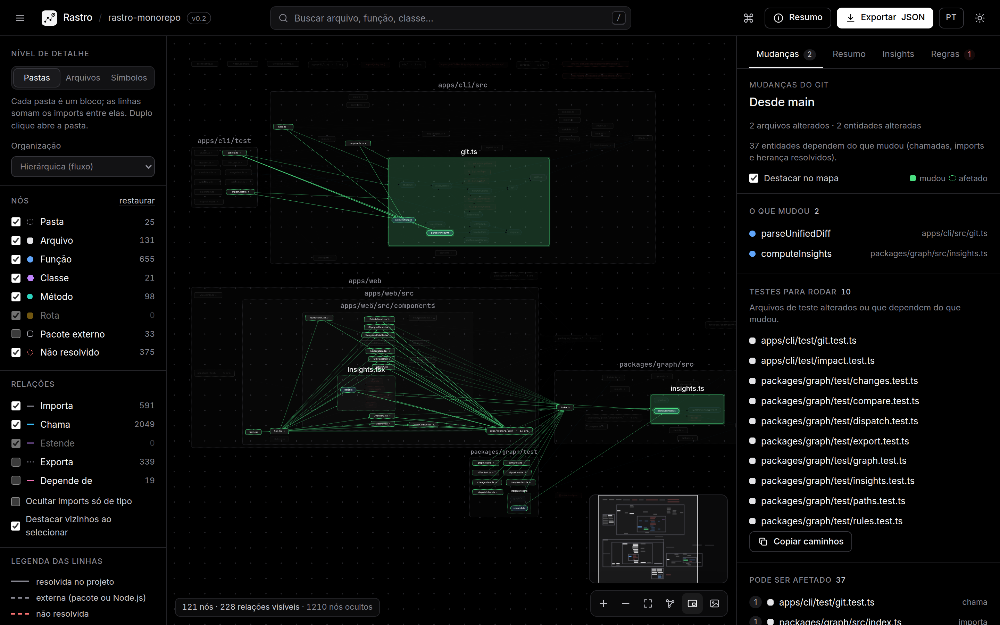</p>

### Como A chega em B?

A partir de qualquer entidade, use **Traçar caminho a partir daqui** e escolha o destino. O Rastro mostra as menores cadeias de chamadas, imports e herança comprovados (até 3 alternativas), cada passo com sua evidência. O mapa passa a mostrar só aquele caminho.

<p align="center">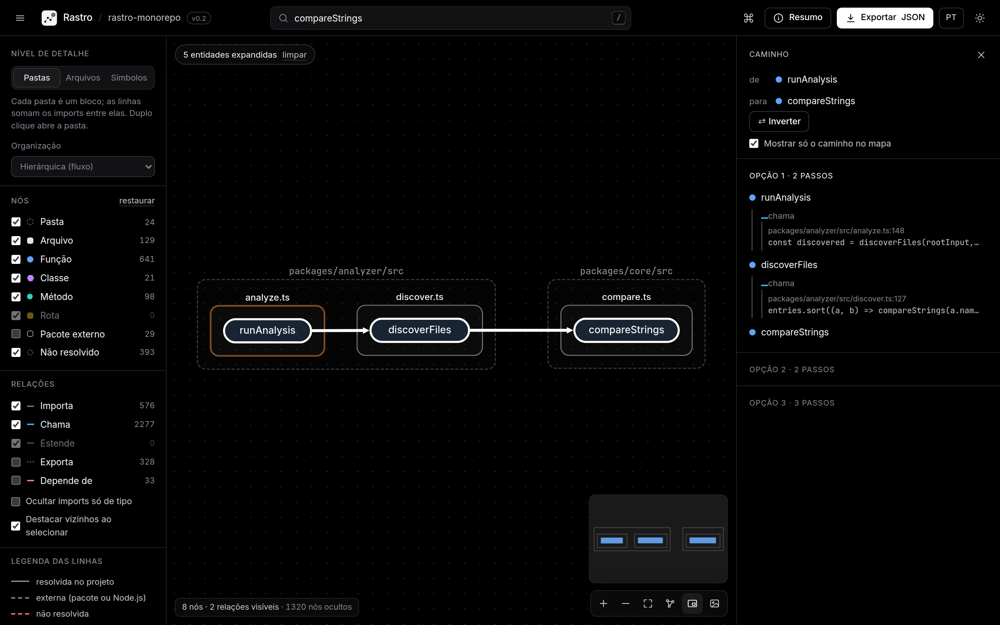</p>

### Por onde começar

A aba **Insights** lista as funções mais chamadas, os orquestradores, os arquivos centrais, os maiores arquivos e as pastas mais acopladas, além do código **possivelmente sem uso**, separando o código interno dos exports que podem ser API pública. Tudo é calculado só com relações comprovadas, e cada item leva ao mapa.

<p align="center">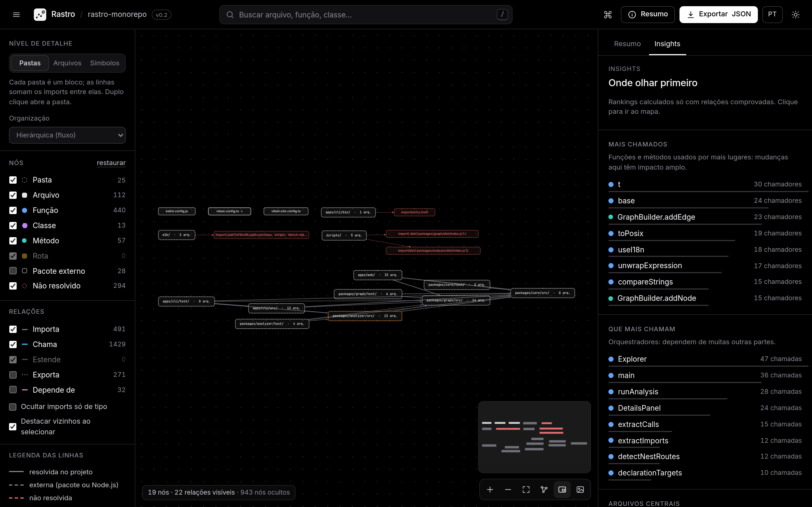</p>

### Navegue na velocidade do pensamento

<kbd>Ctrl</kbd>/<kbd>⌘</kbd>+<kbd>K</kbd> abre uma **paleta de comandos** que encontra entidades e mais de 20 ações de contexto (trocar o nível, focar, traçar caminho, exportar, tema, idioma…). As setas levam ao nó mais próximo naquela direção, <kbd>Alt</kbd>+<kbd>↑</kbd> sobe para quem contém a seleção, <kbd>Backspace</kbd> volta e <kbd>?</kbd> lista todos os atalhos. Há também um **minimapa** e um **breadcrumb** (pasta › arquivo › classe › método).

<p align="center">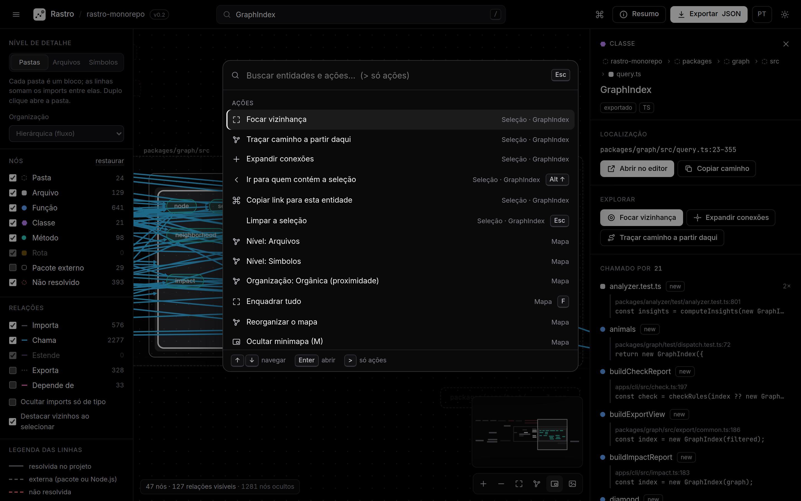</p>

### Honesto sobre o que não consegue provar

Uma chamada por interface ou por método abstrato continua **não resolvida**, e as classes do projeto que a implementam aparecem como candidatas **possíveis**, nunca desenhadas como ligações comprovadas. Chamadas `super(...)` e métodos herdados são resolvidos, e cada pacote de um monorepo usa os aliases `paths` do próprio `tsconfig`.

<p align="center">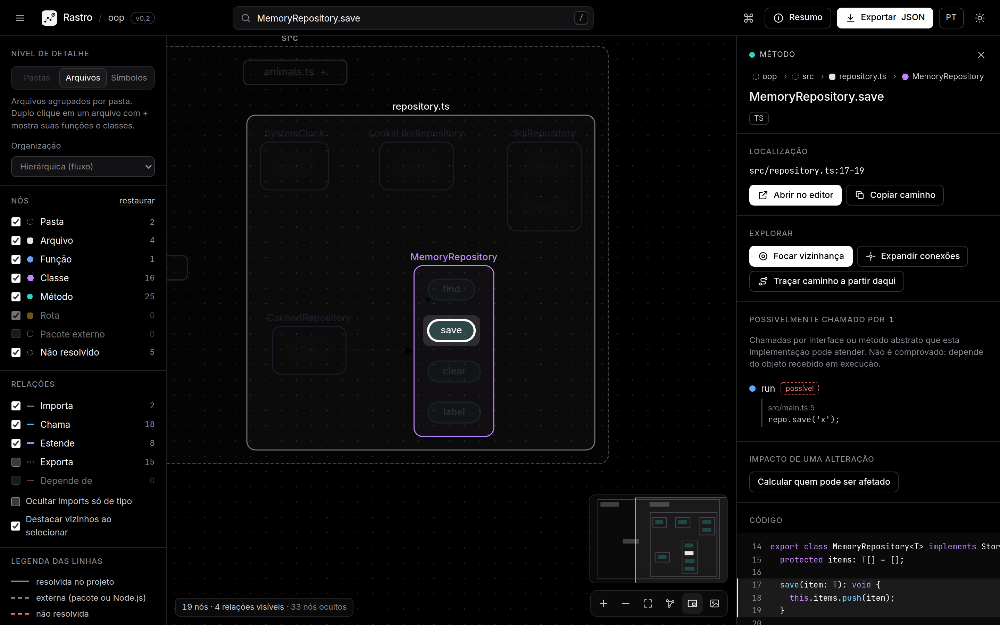</p>

### Também novo

- **Modo ao vivo** (`--watch`): reanálise ao salvar com o compilador mantido em memória (cerca de 2,5 s num projeto de 5 000 arquivos), e o mapa aberto atualiza sem perder a seleção.
- **Mais frameworks**: rotas do Next.js (App e Pages Router), Fastify, Hono e NestJS, além dos prefixos de montagem do Express, com o caminho completo só quando ele pode ser comprovado.
- **Exportar e comparar**: Mermaid, Graphviz DOT, GraphML e um **relatório HTML offline num arquivo só**; `rastro compare a.json b.json` compara duas análises.
- Interface e CLI **bilíngues** (português e inglês).
- **Mais rápido em projetos grandes**: análise cerca de 37% mais rápida, e o nível de arquivos de um projeto com 5 000 arquivos abre em uns 5 s em vez de minutos.

A lista completa está no [changelog](CHANGELOG.md).

## Um passeio pela interface

### Da arquitetura ao detalhe, em três níveis

Projetos grandes começam em **Pastas** (cada pasta é um bloco e as linhas somam os imports entre elas), os pequenos em **Arquivos**; dali, desça até **Símbolos**. O duplo clique abre uma pasta ou mostra as funções de um arquivo. O layout hierárquico desenha o fluxo de dependências da esquerda para a direita; quando o projeto inteiro está numa pasta só (como `src/`), ela já abre sozinha.

<p align="center">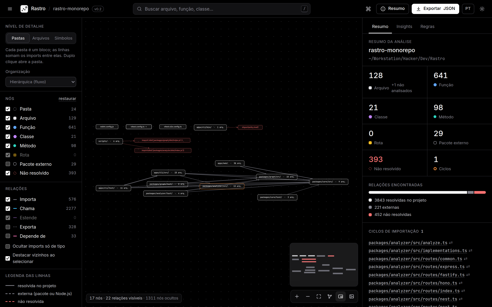</p>

### Selecione e veja tudo o que está conectado

Busque com <kbd>/</kbd> e o mapa leva você até a função, abre o arquivo dela e destaca as conexões. O painel lateral lista **o que ela chama** e **quem a chama**, cada item com `arquivo:linha` e a linha de código. O que não pôde ser comprovado é desenhado com uma linha vermelha tracejada.

<p align="center">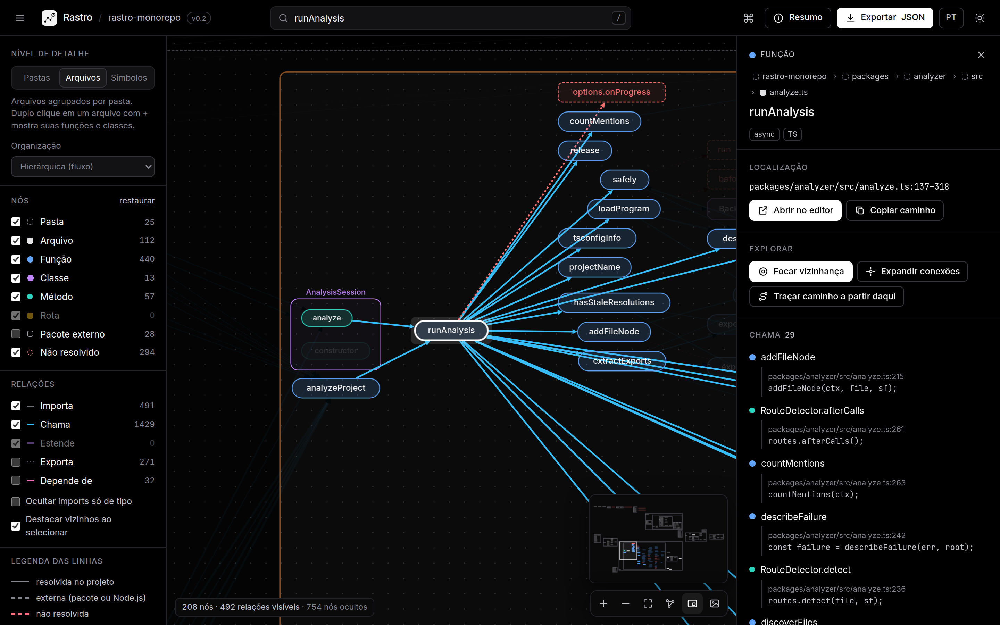</p>

### O código ao lado do mapa

Cada relação é clicável e mostra **cada ocorrência** com o trecho de código e um atalho para o seu editor (VS Code, Cursor, VSCodium, Zed ou JetBrains). O código-fonte da definição aparece no painel, com as linhas relevantes destacadas.

<p align="center">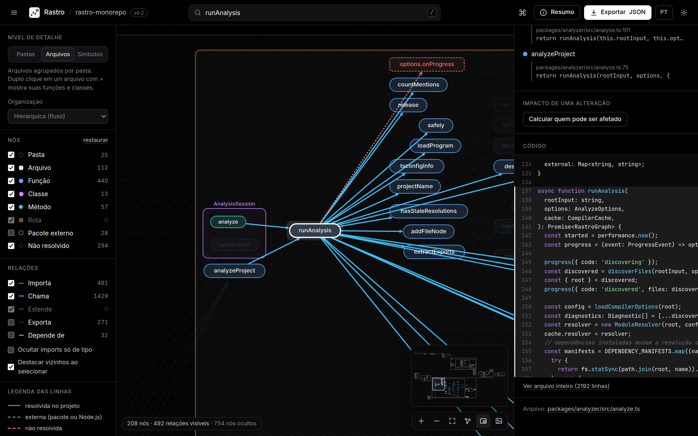</p>

### Rotas HTTP, tema claro e muito mais

As rotas viram nós ligados aos seus handlers, com o caminho completo quando os prefixos de montagem podem ser comprovados. Há também **tema claro**, **foco na vizinhança** (distância 1 a 3), **análise de impacto**, filtros, legenda e exportação para **JSON** e **PNG**.

<p align="center">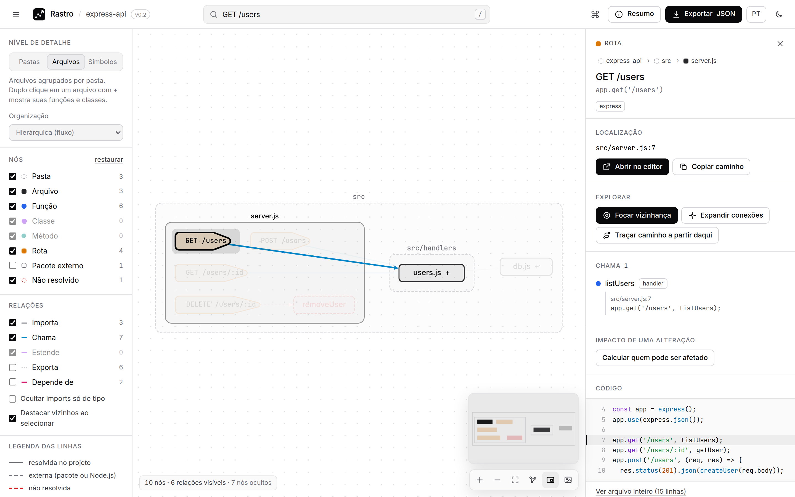</p>

## O que ele entende

| Área           | Suporte na v0.2                                                                                                                                                                                                                                        |
| -------------- | ------------------------------------------------------------------------------------------------------------------------------------------------------------------------------------------------------------------------------------------------------ |
| **Linguagens** | `.js` `.jsx` `.ts` `.tsx` `.mjs` `.cjs` `.mts` `.cts`                                                                                                                                                                                                  |
| **Módulos**    | ESM, CommonJS (`require`, `module.exports`, `exports.x`), `import()` dinâmico, reexportações (`export * from`)                                                                                                                                         |
| **Resolução**  | O compilador do TypeScript via [ts-morph](https://ts-morph.com): `tsconfig`/`jsconfig` (`paths`, `baseUrl`, `references`, `extends`), o `tsconfig` mais próximo de cada pacote de um monorepo, `.js`→`.ts`, `index`                                    |
| **Entidades**  | Funções, classes, métodos (construtor, getters/setters, propriedades-função), componentes React (`memo`, `forwardRef`)                                                                                                                                 |
| **Relações**   | `imports` · `exports` · `contains` · `calls` (inclusive `new`, `<Componente />`, `super(...)` e métodos herdados) · `extends` · `depends_on` (entre pastas) · implementações _possíveis_ de chamadas por interface                                     |
| **Rotas HTTP** | Express (com prefixos de `app.use('/api', router)`), Fastify (`register` com `prefix`), Hono (`app.route`, `basePath`), NestJS (`@Controller` + `@Get`…, prefixo global), Next.js App Router e Pages Router (páginas e rotas de API, `pageExtensions`) |
| **Análises**   | Mudanças do git e seu impacto, caminhos entre entidades, insights (pontos críticos, acoplamento, código possivelmente sem uso), ciclos de importação, análise de impacto, vizinhança, busca, comparação de duas análises                               |

## Honesto por design

Toda relação diz **como** foi descoberta e **se** foi resolvida. Um trecho real do JSON exportado:

```jsonc
{
  "id": "calls:route:src/server.js#app GET /users->fn:src/handlers/users.js#listUsers",
  "kind": "calls",
  "resolution": "resolved", // resolved · external · unresolved
  "discovery": "framework-rule", // static-ast · static-typecheck · derived · framework-rule
  "evidence": [
    {
      "file": "src/server.js",
      "line": 7,
      "column": 19,
      "snippet": "app.get('/users', listUsers);",
    },
  ],
  "meta": { "callKind": "route-handler", "count": 1 },
}
```

Quando algo não pode ser comprovado, o Rastro diz o motivo em vez de chutar: `module-not-found`, `undeclared-package`, `symbol-not-found`, `indirect-call`, `dynamic-import`, `not-analyzed`… Quando o caminho completo de uma rota depende de algo que o Rastro não consegue provar (prefixos que não são literais, versionamento ou `RouterModule` do NestJS, `basePath` do Next.js), ele mostra o caminho como está escrito e deixa o caminho completo de fora. O resumo da análise também mostra o que **ficou de fora do grafo de propósito** (chamadas para bibliotecas, objetos de tipo desconhecido, chamadas por nome calculado).

O formato é versionado (`schemaVersion: "0.1.0"`; a 0.2 só acrescenta campos opcionais), vem com um **JSON Schema** e pode ser validado com `rastro validate grafo.json`. Detalhes em [docs/formato-dos-dados.md](docs/formato-dos-dados.md).

## Como funciona

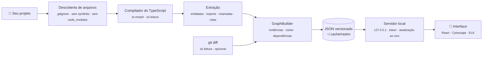

Arquitetura completa em [docs/arquitetura.md](docs/arquitetura.md).

## Linha de comando

```bash
rastro <caminho>                 # analisa e abre o mapa (igual a "rastro open <caminho>")
rastro analyze <caminho>         # só analisa e salva o JSON
rastro analyze <caminho> --stdout  # escreve o JSON na saída padrão
rastro serve <grafo.json>        # abre o mapa de um JSON salvo antes
rastro validate <grafo.json>     # confere se um JSON é um grafo válido
rastro export <caminho|grafo.json> --format mermaid|dot|graphml|json|html
rastro compare <a.json> <b.json> # o que entrou, saiu ou mudou entre duas análises
rastro impact <caminho|grafo.json>  # o impacto das mudanças do git (texto, markdown ou json)
```

| Opção                  | Para que serve                                                                                                                      |
| ---------------------- | ----------------------------------------------------------------------------------------------------------------------------------- |
| `--changes`            | Marca o que mudou desde o último commit (git, inclusive arquivos novos) e o impacto                                                 |
| `--since <ref>`        | Marca o que mudou desde que a branch atual saiu de `<ref>` (ex.: `main`): o impacto de um pull request                              |
| `--trust-git-config`   | Roda o git mesmo se a configuração local do repositório definir comandos (veja [Privacidade e segurança](#privacidade-e-segurança)) |
| `-w, --watch`          | Reanalisa ao salvar arquivos e atualiza o mapa aberto ao vivo                                                                       |
| `-o, --out <arquivo>`  | Onde salvar o JSON (padrão: o cache do usuário, ex.: `~/.cache/rastro`)                                                             |
| `-p, --port <n>`       | Porta da interface (padrão 4321; se estiver ocupada, usa a próxima livre)                                                           |
| `--no-open`            | Não abre o navegador automaticamente                                                                                                |
| `-e, --exclude <glob>` | Ignora caminhos com a sintaxe do `.gitignore` (pode repetir)                                                                        |
| `--no-gitignore`       | Não usa o `.gitignore` do projeto                                                                                                   |
| `--max-files <n>`      | Máximo de arquivos analisados (padrão 10000)                                                                                        |
| `--lang <pt\|en>`      | Idioma das mensagens (padrão: `RASTRO_LANG`, depois o idioma do sistema, depois inglês)                                             |

Opções que não se aplicam a um comando são recusadas com uma explicação, em vez de ignoradas em silêncio.

### Compartilhar e integrar

`rastro export` aceita uma pasta de projeto (analisa antes, respeitando `--exclude`, `--no-gitignore`, `--max-files`, `--changes` e `--since`) ou um `grafo.json` salvo, e escreve na saída padrão, a não ser que você passe `-o`:

```bash
rastro export . --format mermaid > docs/arquitetura.mmd     # cole num PR ou README
rastro export . --format dot --level symbols | dot -Tsvg > mapa.svg
rastro export grafo.json --format graphml -o mapa.graphml    # yEd, Gephi, Cytoscape, networkx
rastro export . --format json --folder src/services          # o grafo de uma pasta só
rastro export . --format html --since main                   # um relatório offline do impacto de um PR
```

| Opção              | Para que serve                                                                              |
| ------------------ | ------------------------------------------------------------------------------------------- |
| `-f, --format <f>` | `mermaid`, `dot`, `graphml`, `json` ou `html`                                               |
| `--level <nível>`  | `modules` (pastas recolhidas), `files` (padrão) ou `symbols`: os mesmos níveis da interface |
| `--folder <pasta>` | Só esta pasta e suas subpastas, ex.: `src/services`                                         |
| `--edges <tipos>`  | Relações desenhadas, ex.: `imports,calls` (padrão: `imports,calls,extends`)                 |
| `--external`       | Inclui pacotes externos (npm, módulos nativos do Node.js)                                   |
| `--no-unresolved`  | Deixa de fora as referências não resolvidas                                                 |

`--level`, `--edges`, `--external` e `--no-unresolved` valem para `mermaid`, `dot` e `graphml`; `--folder` vale para todos os formatos.

- **Mermaid** usa subgrafos para pastas (e para arquivos e classes no nível `symbols`), nós e linhas vermelhos tracejados para referências não resolvidas e cinza tracejados para pacotes externos. Diagramas com mais de 400 nós são recusados com uma dica (`--level modules` ou `--folder`), porque o Mermaid deixa de ser legível e o GitHub recusa diagramas grandes.
- **DOT** (Graphviz) e **GraphML** não têm limite de tamanho. O GraphML guarda `kind`, `resolution`, `count`, `file` e `line` como atributos.
- **HTML** é um **arquivo único e offline** com o mapa interativo completo: JavaScript, estilos, fontes e o grafo vão embutidos, ele abre direto do disco (sem servidor, sem internet) e uma Content Security Policy bloqueia qualquer acesso à rede. Com `--changes` ou `--since`, inclui a aba **Mudanças**. O código-fonte não vai junto, e a pasta pessoal no caminho do projeto vira `~`. Ótimo para mandar ao time ou anexar a um PR.

`rastro compare antes.json depois.json` lista as entidades que entraram e saíram, as relações adicionadas, removidas ou com resolução diferente, os ciclos de importação novos ou resolvidos e a diferença nos números (arquivos, funções, referências não resolvidas, ciclos…). Use `--json` para um diff legível por máquina (no CI, por exemplo).

### Relatório de impacto

`rastro impact` analisa a pasta (ou lê um grafo salvo com `--changes`/`--since`) e mostra o que mudou, o que pode ser afetado (com a distância e a relação que leva até lá), as rotas HTTP envolvidas, os arquivos de teste para rodar e os arquivos alterados que estão fora do mapa.

| Opção                 | Para que serve                                                                                    |
| --------------------- | ------------------------------------------------------------------------------------------------- |
| `--since <ref>`       | Compara com o ponto em que a branch saiu de `<ref>` (padrão: o que ainda não foi commitado)       |
| `-f, --format <f>`    | `text` (padrão), `markdown` ou `json`                                                             |
| `--tests`             | Mostra só os arquivos de teste afetados, um por linha, relativos à pasta atual                    |
| `--link <url>`        | Transforma `arquivo:linha` em links no Markdown, ex.: `https://github.com/org/repo/blob/<commit>` |
| `-o, --out <arquivo>` | Grava num arquivo em vez da saída padrão                                                          |

Tudo o que vem do projeto analisado (nomes, caminhos) entra no Markdown como código, então um nome de arquivo não consegue injetar links, imagens, menções ou HTML num comentário de pull request.

### GitHub Action

`uses: MongeAI/rastro@v0.2.0` analisa o pull request, escreve o relatório no resumo do job, comenta no pull request (um comentário por `path` analisado, atualizado a cada push) e envia o mapa HTML offline como o artefato `rastro-report`. Num monorepo, chame a action uma vez por pacote, com `path` e `artifact-name` diferentes: cada chamada tem o seu comentário, as suas saídas e o seu relatório. Os links do comentário apontam para o commit analisado e para o caminho do arquivo no repositório.

| Entrada          | Padrão                 | Para que serve                                                      |
| ---------------- | ---------------------- | ------------------------------------------------------------------- |
| `path`           | `.`                    | Pasta do projeto a analisar                                         |
| `base`           | a base do pull request | Branch para comparar                                                |
| `exclude`        |                        | Caminhos a ignorar, um por linha (sintaxe do `.gitignore`)          |
| `comment`        | `true`                 | Comenta no pull request                                             |
| `github-token`   | `${{ github.token }}`  | Token usado para comentar no pull request                           |
| `comment-author` | `github-actions[bot]`  | Login que publica o comentário (troque se usar outro token)         |
| `report`         | `true`                 | Envia o relatório HTML offline                                      |
| `artifact-name`  | `rastro-report`        | Nome do artefato (um por chamada, se usar a action mais de uma vez) |
| `lang`           | `en`                   | `en` ou `pt`                                                        |
| `version`        | `0.2.0`                | Versão do `@mongeai/rastro` a rodar                                 |

Saídas: `tests` (arquivos de teste afetados, um por linha), `changed`, `impacted`, `markdown` e `json` (caminhos dos relatórios). Para rodar só os testes afetados num passo seguinte, passe a saída por uma variável de ambiente (nunca direto no `run:`):

```yaml
- id: rastro
  uses: MongeAI/rastro@v0.2.0
- name: Testes afetados primeiro
  if: steps.rastro.outputs.tests != ''
  env:
    TESTS: ${{ steps.rastro.outputs.tests }}
  run: printf '%s\n' "$TESTS" | xargs -r -d '\n' npx vitest run
```

Pull requests de forks recebem um token só de leitura, então o comentário é pulado com um aviso; o resumo do job continua com o relatório completo.

**Segurança.** A action nunca executa código do pull request. O Rastro é instalado fora do checkout, do registro público do npm, sem scripts de instalação e sem o `.npmrc` ou o `NODE_OPTIONS` do repositório; ele só lê arquivos e roda o git em modo leitura. Só são atualizados comentários escritos por `comment-author`, então ninguém toma o comentário publicando o marcador. Todo nome que vem do código é escapado no comentário. Use o evento `pull_request` (não `pull_request_target`).

### Atalhos de teclado

| Teclas                                              | Ação                                                      |
| --------------------------------------------------- | --------------------------------------------------------- |
| <kbd>Ctrl</kbd>/<kbd>⌘</kbd>+<kbd>K</kbd>           | Paleta de comandos: entidades e ações (`>` para só ações) |
| <kbd>/</kbd>                                        | Buscar                                                    |
| <kbd>←</kbd> <kbd>↑</kbd> <kbd>→</kbd> <kbd>↓</kbd> | Ir para o nó mais próximo naquela direção                 |
| <kbd>Enter</kbd>                                    | Expandir ou recolher a seleção (arquivo ou pasta)         |
| <kbd>Alt</kbd>+<kbd>↑</kbd>                         | Ir para quem contém a seleção                             |
| <kbd>Backspace</kbd>                                | Voltar para a seleção anterior                            |
| <kbd>F</kbd> · <kbd>M</kbd>                         | Enquadrar o mapa · mostrar ou ocultar o minimapa          |
| <kbd>Esc</kbd>                                      | Fechar, limpar a seleção ou sair do foco                  |
| <kbd>?</kbd>                                        | Listar todos os atalhos                                   |

A URL guarda a seleção (`#n=…`). Com `rastro <caminho>`, o link funciona na mesma sessão do navegador (o token do servidor vale por uma execução); no relatório HTML (`rastro export --format html`), funciona sempre.

## Desempenho

Medido em projetos sintéticos (`npm run bench`, também conferido no CI):

| Arquivos | Nós    | Relações | Análise | Pico de memória |
| -------- | ------ | -------- | ------- | --------------- |
| 100      | 712    | 2.594    | 0,4 s   | 216 MB          |
| 1.000    | 7.041  | 26.692   | 1,0 s   | 303 MB          |
| 5.000    | 35.140 | 133.745  | 3,3 s   | 661 MB          |

Projetos reais com muita inferência de tipos levam mais tempo que o benchmark sintético: projetos de 450 a 1 000 arquivos (Hono, tRPC, Excalidraw) levaram de 9 a 11 s na nossa máquina.

No modo `--watch`, reanalisar um projeto de 5 000 arquivos depois de salvar leva cerca de 2,5 s. Mapas muito grandes passam a um estilo de desenho mais leve (linhas retas, uma imagem enquanto você arrasta) para continuar responsivos.

## Privacidade e segurança

- 🔒 **Local-first.** Nenhum código sai da sua máquina. Sem conta, sem API paga, sem telemetria, sem CDN.
- 📖 **Só leitura.** O Rastro **nunca executa** o projeto analisado, nunca roda os scripts do `package.json` e nunca instala as dependências dele. A suíte de testes confere isso.
- 🌿 **Cuidado com o git.** `--changes` e `--since` só rodam comandos de leitura do git, com ferramentas externas de diff, conversão de texto, hooks, pagers e fsmonitor desligados. O git nunca entra em submódulos, e a pasta analisada é sempre lida como caminho literal. Se a configuração local ou do worktree do repositório definir comandos que o git executaria (filtros, por exemplo), o Rastro se recusa, a não ser que você passe `--trust-git-config`. Use só em repositórios em que você confia.
- 🛡️ **Servidor trancado.** Ele só escuta em `127.0.0.1`, exige um **token aleatório por execução**, só aceita `GET`/`HEAD`, bloqueia DNS rebinding e só entrega o código-fonte de arquivos que fazem parte do grafo. As atualizações ao vivo usam as mesmas proteções.
- 🧭 **Nada é gravado no seu repositório.** Os resultados vão para a pasta de cache do usuário (ou para `--out`).

O JSON exportado contém o caminho absoluto do projeto e trechos de código. Revise antes de compartilhar. Mais em [docs/seguranca.md](docs/seguranca.md) e [SECURITY.md](SECURITY.md).

## Limitações conhecidas

- Só entende **JavaScript e TypeScript**.
- Chamadas dinâmicas (callbacks, `obj[nome]()`, injeção de dependência, eventos) aparecem como não resolvidas ou só nos contadores. Chamadas por interface listam implementações _possíveis_, nunca comprovadas; métodos sobrescritos não entram como candidatos.
- Em JavaScript sem tipos, `obj.metodo()` só é ligado quando o TypeScript consegue inferir o tipo de `obj`.
- Funções declaradas dentro de outras funções não viram nós próprios.
- Membros CommonJS atribuídos em tempo de execução (`app.init = function () {}`, `View.prototype.render = …`) não viram nós, então chamadas a eles ficam não resolvidas.
- Quando um pacote traz tipos `.d.ts` escritos à mão ao lado do JavaScript (como o Fastify), as chamadas caem nas assinaturas de tipo e ficam não resolvidas como “não analisado”.
- Globais de executores de teste (`describe`, `it`, `expect`) ficam não resolvidos, já que o Rastro nunca instala pacotes `@types`.
- As rotas só são detectadas quando o framework é comprovado (importado do pacote dele, ou `next` declarado no `package.json`) e o caminho é um literal. Ainda não cobertos: roteadores ou apps passados como parâmetro de função (exceto plugins do Fastify), `fastify-plugin`/autoload e o middleware do Next.js.
- "Possivelmente sem uso" é uma pista: código usado só por acesso dinâmico, reflexão ou por outros pacotes pode aparecer ali.
- O `--watch` reanalisa o projeto inteiro a cada salvamento (o compilador é reaproveitado, as relações são recalculadas); um cache das relações por arquivo está nos planos.

Os próximos passos estão no [roadmap](ROADMAP.md).

## Estrutura do repositório

```
apps/cli           CLI `rastro`: análise, mudanças do git, armazenamento local, servidor e modo ao vivo
apps/web           Interface (React + Cytoscape.js + ELK)
packages/core      Modelo de dados, JSON Schema, validação e rótulos/diagnósticos traduzidos
packages/graph     GraphBuilder, ciclos, consultas, visões, insights, caminhos, mudanças, exportação e comparação
packages/analyzer  Analisador JS/TS sobre o ts-morph
fixtures           Projetos de exemplo usados nos testes
e2e                Testes da interface no Chrome headless
docs               Arquitetura, formato dos dados, segurança e imagens
```

## Contribuindo

Contribuições são muito bem-vindas, principalmente exemplos de código que o Rastro entende errado.

```bash
npm test             # testes de unidade (Vitest)
npm run test:e2e     # testes da interface no Chrome headless (depois de npm run build)
npm run bench        # benchmarks
npm run lint         # ESLint
npm run format       # Prettier
npm run typecheck    # TypeScript em todos os pacotes
```

Para trabalhar na interface com recarga automática, rode `npx rastro fixtures/ts-basic --port 4321 --no-open` num terminal e `npm run dev:web` em outro. Abra uma vez a URL com token do primeiro terminal e depois use `http://127.0.0.1:5173`.

Veja o [CONTRIBUTING.md](CONTRIBUTING.md). Encontrou um problema de segurança? Siga o [SECURITY.md](SECURITY.md).

## Licença

[MIT](LICENSE) © [MongeAI](https://github.com/MongeAI). As fontes Inter e JetBrains Mono incluídas na interface usam a SIL Open Font License 1.1.

<p align="center"><sub>Feito no Brasil 🇧🇷 pela MongeAI.</sub></p>
