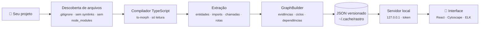

<p align="center">
  <picture>
    <source media="(prefers-color-scheme: dark)" srcset="docs/assets/banner-dark.svg" />
    
  </picture>
</p>

<p align="center">
  <a href="README.md">English</a> · <b>Português</b>
</p>

<p align="center">
  <a href="https://github.com/MongeAI/rastro/actions/workflows/ci.yml"></a>
  <a href="https://www.npmjs.com/package/@mongeai/rastro"></a>
  <a href="LICENSE"></a>
  
  
  
</p>

<p align="center">
  <b>Entenda um código que você nunca viu em minutos, não em dias.</b><br />
  O Rastro lê um repositório JavaScript/TypeScript e abre no seu navegador um <b>mapa interativo</b> de pastas, arquivos, funções e classes,<br />
  em que <b>cada ligação aponta para o arquivo e a linha que a comprovam</b>. Tudo na sua máquina, sem nuvem e sem IA obrigatória.
</p>

<p align="center">
  
</p>

---

## Por que o Rastro?

Você caiu em um projeto novo. Antes de mexer em qualquer coisa, precisa responder:

- 🗺️ **Quais são os módulos e como eles se conectam?**
- 🔗 **Quem chama esta função? Ela chama o quê?**
- 💥 **Se eu alterar isto, o que pode quebrar?**
- 🔁 **Existem ciclos de importação?**
- 🛣️ **Quais rotas HTTP existem e qual função atende cada uma?**
- ❓ **O que o código referencia, mas não dá para comprovar estaticamente?**

O Rastro responde tudo isso num mapa navegável, e com uma regra de ouro:

> **Nada de conexões inventadas.** Toda relação no grafo tem um _rastro_ até o código: arquivo, linha e o trecho exato. O que não pode ser provado (callbacks, `obj[nome]()`, imports dinâmicos) aparece como **não resolvido**, com o motivo.

## Comece em um minuto

Pré-requisito: **Node.js 22.12+**. Na pasta de qualquer projeto JS/TS:

```bash
npx @mongeai/rastro .
```

Ou instale o comando de vez com `npm install -g @mongeai/rastro` e use `rastro ./caminho/do/projeto`.

O terminal mostra um resumo e o navegador abre sozinho:

```text
rastro-monorepo ~/rastro
  51 arquivos analisados · 140 funções · 3 classes · 23 métodos · 26 pacotes externos · 43 não resolvidos
  relações: 820 resolvidas · 66 externas · 50 não resolvidas
  1 ciclo(s) de importação
  análise em 1823 ms com TypeScript 6.0.2

Rastro pronto em http://127.0.0.1:4321/?token=…  (Ctrl+C para encerrar)
```

<details>
<summary><b>Rodar a partir do código-fonte</b></summary>

```bash
git clone https://github.com/MongeAI/rastro.git
cd rastro
npm install
npm run build
npx rastro fixtures/ts-basic        # ou fixtures/express-api, ou o caminho de qualquer projeto
```

Para ter esse build como comando global: `npm link -w apps/cli` (desfazer: `npm unlink -g rastro`).

</details>

## Um passeio pela interface

### 1. Da arquitetura ao detalhe, em três níveis

Comece pelas **Pastas** (cada pasta é um bloco e as linhas somam os imports entre elas), desça para **Arquivos** e chegue aos **Símbolos**. Dois cliques abrem uma pasta ou mostram as funções de um arquivo. O layout hierárquico desenha o fluxo de dependências da esquerda para a direita.

<p align="center"></p>

### 2. Selecione e veja tudo o que está conectado

Busque com <kbd>/</kbd> e o mapa leva você até a função, abre o arquivo dela e destaca as conexões. O painel lista **o que ela chama** e **quem a chama**, cada item com `arquivo:linha` e a linha de código. Em vermelho tracejado, o que não pôde ser comprovado.

<p align="center"></p>

### 3. Clique numa linha e veja as provas

Toda aresta é clicável: o painel mostra **cada ocorrência** daquela relação, com o trecho de código e um atalho para abrir no editor (VS Code, Cursor, VSCodium, Zed ou JetBrains).

<p align="center"></p>

### 4. O código ao lado do mapa

O trecho da definição aparece no painel, com a região destacada, sem sair da ferramenta.

<p align="center"></p>

### 5. Rotas HTTP, tema claro e muito mais

Rotas do **Express** viram nós ligados aos seus handlers. Também há **tema claro**, **foco na vizinhança** (distância 1 a 3), **análise de impacto**, filtros, legenda e exportação em **JSON** e **PNG**.

<p align="center"></p>

## O que ele entende

| Área           | Suporte na v0.1                                                                                                                                          |
| -------------- | -------------------------------------------------------------------------------------------------------------------------------------------------------- |
| **Linguagens** | `.js` `.jsx` `.ts` `.tsx` `.mjs` `.cjs` `.mts` `.cts`                                                                                                    |
| **Módulos**    | ESM, CommonJS (`require`, `module.exports`, `exports.x`), `import()` dinâmico, reexportações (`export * from`)                                           |
| **Resolução**  | Compilador do TypeScript via [ts-morph](https://ts-morph.com): `tsconfig`/`jsconfig` (`paths`, `baseUrl`, `references`), `.js`→`.ts`, `index`, monorepos |
| **Entidades**  | Funções, classes, métodos (construtor, getters/setters, propriedades-função), componentes React (`memo`, `forwardRef`), rotas Express                    |
| **Relações**   | `importa` · `exporta` · `contém` · `chama` (incluindo `new` e `<Componente />`) · `estende` · `depende de` (entre pastas)                                |
| **Análises**   | Ciclos de importação, análise de impacto, vizinhança, busca                                                                                              |

## Honesto por design

Cada relação diz **como** foi descoberta e **se** foi resolvida. Um trecho real do JSON exportado:

```jsonc
{
  "id": "calls:route:src/server.js#app GET /users->fn:src/handlers/users.js#listUsers",
  "kind": "calls",
  "resolution": "resolved", // resolved · external · unresolved
  "discovery": "framework-rule", // static-ast · static-typecheck · derived · framework-rule
  "evidence": [
    {
      "file": "src/server.js",
      "line": 7,
      "column": 19,
      "snippet": "app.get('/users', listUsers);",
    },
  ],
  "meta": { "callKind": "route-handler", "count": 1 },
}
```

Quando não dá para provar, o Rastro diz o motivo em vez de chutar: `module-not-found`, `undeclared-package`, `symbol-not-found`, `indirect-call`, `dynamic-import`, `not-analyzed`… O resumo da análise também mostra o que ficou **fora do grafo por cautela** (chamadas a bibliotecas, objetos sem tipo conhecido, chamadas por nome calculado).

O formato é versionado (`schemaVersion: "0.1.0"`), tem **JSON Schema** e pode ser validado com `rastro validate grafo.json`. Detalhes em [docs/formato-dos-dados.md](docs/formato-dos-dados.md).

## Como funciona



Arquitetura completa em [docs/arquitetura.md](docs/arquitetura.md).

## Linha de comando

```bash
rastro <caminho>                  # analisa e abre o mapa (igual a "rastro open <caminho>")
rastro analyze <caminho>          # só analisa e salva o JSON
rastro analyze <caminho> --stdout # escreve o JSON na saída padrão
rastro serve <grafo.json>         # abre o mapa de um JSON salvo antes
rastro validate <grafo.json>      # confere se um JSON é um grafo válido
rastro export <caminho|grafo.json> --format mermaid|dot|graphml|json|html
rastro compare <a.json> <b.json>  # o que entrou, saiu ou mudou entre duas análises
```

| Opção                    | Para quê                                                             |
| ------------------------ | -------------------------------------------------------------------- |
| `-o, --out <arquivo>`    | Onde salvar o JSON (padrão: cache do usuário, ex. `~/.cache/rastro`) |
| `-p, --port <n>`         | Porta da interface (padrão 4321; se ocupada, usa a próxima livre)    |
| `--no-open`              | Não abre o navegador automaticamente                                 |
| `-e, --exclude <padrão>` | Ignora caminhos, com a sintaxe do `.gitignore` (pode repetir)        |
| `--no-gitignore`         | Não usa o `.gitignore` do projeto                                    |
| `--max-files <n>`        | Limite de arquivos analisados (padrão 10000)                         |

### Compartilhar e integrar

`rastro export` recebe a pasta do projeto (analisa antes, respeitando `--exclude`, `--no-gitignore` e `--max-files`) ou um `grafo.json` salvo, e escreve na saída padrão se você não passar `-o`:

```bash
rastro export . --format mermaid > docs/arquitetura.mmd     # cole num PR ou README
rastro export . --format dot --level symbols | dot -Tsvg > mapa.svg
rastro export grafo.json --format graphml -o mapa.graphml    # yEd, Gephi, Cytoscape, networkx
rastro export . --format json --folder src/services          # o grafo de uma pasta só
rastro export . --format html                                # ./<projeto>.rastro.html
```

| Opção              | Para quê                                                                                    |
| ------------------ | ------------------------------------------------------------------------------------------- |
| `-f, --format <f>` | `mermaid`, `dot`, `graphml`, `json` ou `html`                                               |
| `--level <nível>`  | `modules` (pastas recolhidas), `files` (padrão) ou `symbols`: os mesmos níveis da interface |
| `--folder <pasta>` | Só esta pasta e suas subpastas, ex. `src/services`                                          |
| `--edges <tipos>`  | Relações desenhadas, ex. `imports,calls` (padrão: `imports,calls,extends`)                  |
| `--external`       | Inclui pacotes externos (npm, módulos do Node.js)                                           |
| `--no-unresolved`  | Deixa de fora as referências não resolvidas                                                 |

- **Mermaid** usa subgrafos para as pastas (e para arquivos e classes no nível `symbols`), nós e linhas vermelhos tracejados para referências não resolvidas e cinza tracejados para pacotes externos. Acima de 400 nós o diagrama é recusado com uma dica (`--level modules` ou `--folder`), porque o Mermaid deixa de ser legível e o GitHub recusa diagramas grandes.
- **DOT** (Graphviz) e **GraphML** não têm limite de tamanho. O GraphML guarda `kind`, `resolution`, `count`, `file` e `line` como atributos.
- **HTML** é um **arquivo único e offline** com o mapa navegável completo: JavaScript, estilos, fontes e o grafo vão embutidos, ele abre direto do disco (sem servidor e sem internet) e uma Content Security Policy bloqueia qualquer acesso à rede. O código-fonte não vai junto, e a sua pasta pessoal no caminho do projeto vira `~`. Bom para mandar ao time ou anexar a um PR.

`rastro compare antes.json depois.json` lista as entidades que entraram e saíram, as relações novas, removidas ou que mudaram de resolução, ciclos de importação novos ou desfeitos e a diferença nos números (arquivos, funções, referências não resolvidas, ciclos…). Use `--json` para um resultado legível por máquina (no CI, por exemplo).

Atalhos na interface: <kbd>/</kbd> busca · <kbd>F</kbd> enquadra · <kbd>Esc</kbd> limpa a seleção · dois cliques abrem pastas e arquivos · a URL guarda a seleção (`#n=…`).

## Privacidade e segurança

- 🔒 **Local-first.** Nenhum código sai da sua máquina. Sem conta, sem API paga, sem telemetria, sem CDN.
- 📖 **Só leitura.** O Rastro **não executa** o projeto analisado, não roda scripts do `package.json` e não instala dependências. Os testes conferem isso.
- 🛡️ **Servidor restrito.** Escuta só em `127.0.0.1`, exige um **token aleatório por execução**, aceita só `GET`/`HEAD`, bloqueia DNS rebinding e só entrega código de arquivos que fazem parte do grafo.
- 🧭 **Nada gravado no seu repositório.** O resultado vai para a pasta de cache do usuário (ou para `--out`).

O JSON exportado contém o caminho absoluto do projeto e trechos de código. Revise antes de compartilhar. Mais em [docs/seguranca.md](docs/seguranca.md).

## Limitações conhecidas

O Rastro está na **v0.1**. Hoje:

- Entende apenas **JavaScript e TypeScript**.
- Chamadas dinâmicas (callbacks, `obj[nome]()`, injeção de dependência, eventos) aparecem como não resolvidas ou só nas contagens.
- Em JavaScript sem tipos, `obj.metodo()` só é ligado quando o TypeScript consegue inferir o tipo de `obj`.
- Funções declaradas dentro de outras funções não viram nós próprios.
- Rotas: só **Express**, com caminho literal e `app`/`router` criado no próprio código.
- Monorepos usam o `tsconfig` da raiz (e seus `references`); `paths` só de subpacotes podem não ser resolvidos.
- Testado em projetos de dezenas a algumas centenas de arquivos; num teste sintético, cerca de 1 000 arquivos foram analisados em ~3 s.

Próximos passos no [roadmap](ROADMAP.md): mais frameworks de rotas, análise incremental, diff entre versões e impacto de um _pull request_.

## Estrutura do repositório

```
apps/cli           CLI `rastro`: análise, armazenamento local e servidor
apps/web           Interface (React + Cytoscape.js + ELK)
packages/core      Modelo de dados, JSON Schema e validação
packages/graph     GraphBuilder, ciclos, consultas e cálculo da visão
packages/analyzer  Analisador JS/TS baseado em ts-morph
fixtures           Projetos de exemplo usados nos testes
docs               Arquitetura, formato dos dados, segurança e imagens
```

## Contribuindo

Contribuições são muito bem-vindas, principalmente exemplos de código que o Rastro entende errado.

```bash
npm test             # testes (Vitest)
npm run lint         # ESLint
npm run format       # Prettier
npm run typecheck    # TypeScript em todos os pacotes
```

Para desenvolver a interface com recarga automática, rode `npx rastro fixtures/ts-basic --port 4321 --no-open` num terminal e `npm run dev:web` em outro. Abra uma vez a URL com token do primeiro terminal; depois use `http://127.0.0.1:5173`.

Veja o [CONTRIBUTING.md](CONTRIBUTING.md). Encontrou uma falha de segurança? Siga o [SECURITY.md](SECURITY.md).

## Licença

[MIT](LICENSE) © [MongeAI](https://github.com/MongeAI). As fontes Inter e JetBrains Mono embutidas na interface usam a SIL Open Font License 1.1.

<p align="center"><sub>Feito no Brasil 🇧🇷 pela MongeAI.</sub></p>
